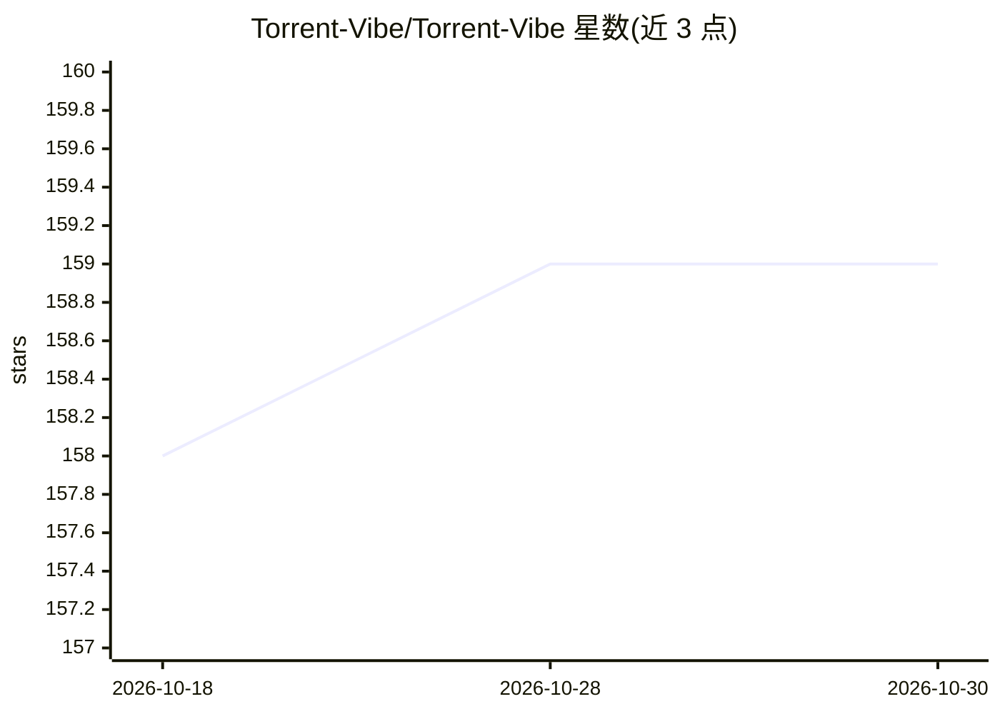

# Torrent-Vibe/Torrent-Vibe

⭐ 159 · TypeScript · 推送 2026-09-25 · [GitHub](https://github.com/Torrent-Vibe/Torrent-Vibe) · [官网](https://qb-webui-site-inneis-projects.vercel.app) · 组织维护

**qBittorrent 的现代化替代 Web 界面，含 AI 元数据增强**

面向 qBittorrent 用户的增强型 Web 界面，可替换或配合默认 WebUI 使用：提供实时速度监控、分类与标签管理、带宽控制、偏好设置管理等功能；桌面端（Electron）额外支持多 qBittorrent 服务器统一管理、远程路径映射到本地存储的文件打开操作，以及 AI 驱动的种子名称解析与元数据提取（标题、年份、媒体类型），集成 TMDB 影视信息。AI 功能仅在设置中配置 OpenAI API key 后显示。安装方式为 Releases 下载应用或 Web 包，并配置 qBittorrent 使用替代 Web UI。

## 筛选速览

| 维度 | 判定 | 备注 |
|---|---|---|
| AI 角色 | `ai-enhanced` | 去掉 AI 部分产品仍成立 |
| 许可风险 | `none` | — |
| 部署形态 | `desktop` | 安装包/桌面程序 |
| 模型依赖 | — | README 未给出锁定关系 |
| 硬件要求 | — | 无带数字的原话,不猜 |
| 安装摩擦 | `low` | 无编译、无系统依赖或容器化 |
| 成熟度 | — | 结构信号不足 |

## 能力要点

- 替代 qBittorrent 默认 WebUI 的 Web 界面，支持实时监控与高级过滤
- Electron 桌面端支持多服务器管理与远程路径映射
- AI 元数据增强：种子名解析、TMDB 影视信息、置信度评分
- AI 功能需配置 OpenAI API key，多语言本地化标题建议

## 适用场景

- 想给 qBittorrent 换一个更现代的网页管理界面
- 同时管理多个 qBittorrent 服务器并快速切换
- 自动识别种子内容并关联 TMDB 影视信息

## 场景标签

 · 领域:下载工具/桌面应用

## 证据(README 行号)

> L9: Torrent Vibe is an enhanced web interface designed to replace or complement the default qBittorrent WebUI. It provid
> L85: ### 🤖 AI-Powered Metadata Enrichment (Electron)
> L92: - Only displays when OpenAI API key is configured in settings

## 星数曲线

2026-10-18 158 → 2026-10-30 159（+1）

---
*卡片 v1 · prompt 1.4 · 生成 2026-10-22 · 置信度 high · 依据 README sha `48e2db0eb995` · [字段定义](../../DATASET.md)*
