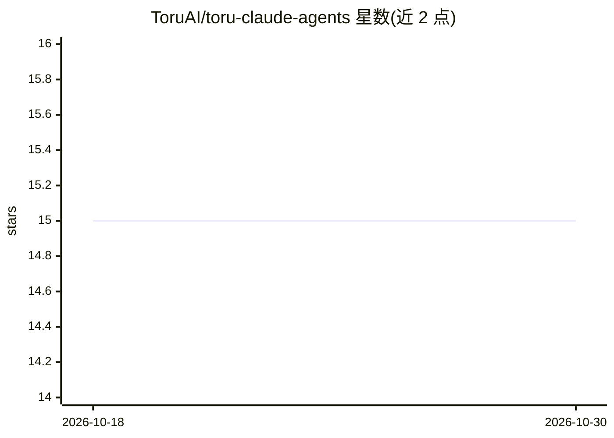

# ToruAI/toru-claude-agents

⭐ 15 · Shell · MIT · 推送 2026-07-26 · [GitHub](https://github.com/ToruAI/toru-claude-agents) · 组织维护

**Claude Code 多智能体开发工作流插件：7 个专家代理与机器可验证的完成门槛**

ToruAI 发布的 Claude Code 插件，包含 7 个专职代理（规划、构建、安全审计、代码侦察、数据、设计、客户文书）与 14 个技能命令，组成 /dev-cycle→/dev-qa→/dev-security→/dev-rc→/dev-finish 流水线，退出条件为测试、lint、类型、构建通过及安全审计通过。常驻上下文约 1.1k tokens；PreToolUse 钩子机械阻断 git push。提供插件市场与 install.sh 两种安装路径，megg 记忆层为可选（需 Node.js 20+），jq 为推送守卫的必需依赖。门槛由 Claude 执行命令并读取退出码强制，非 CI。

## 筛选速览

| 维度 | 判定 | 备注 |
|---|---|---|
| AI 角色 | `ai-ecosystem` | LLM/agent 周边工具 |
| 许可风险 | `permissive` | MIT |
| 部署形态 | `library` | 以包/库形式分发 |
| 模型依赖 | locked-api |  |
| 硬件要求 | — | 无带数字的原话,不猜 |
| 安装摩擦 | `low` | 无编译、无系统依赖或容器化 |
| 成熟度 | — | 结构信号不足 |

## 能力要点

- 7 个代理 + 14 个技能组成端到端开发流水线，退出条件机器可验证
- PreToolUse 钩子机械阻断 git push（push-guard.sh 带独立测试套件）
- 两种安装路径：插件市场安装或 install.sh 符号链接至 ~/.claude/
- 可选 megg 记忆层（npx megg@1.1.0）支持跨会话记忆

## 适用场景

- 在 Claude Code 中以固定流水线完成特性开发与质量门槛
- 让安全代理对代码做漏洞与泄露密钥审计
- 通过 /scout 只读探索陌生代码库
- 用会话文件保存进度，跨终端关闭延续任务

## 场景标签

`多智能体` `编码 Agent` · 领域:Agent 开发

## 证据(README 行号)

> L3: Claude Code Plugin
> L7: **A dev workflow for Claude Code that won't call your work done until your tests, linter and build exit zero — and w
> L16: /plugin marketplace add ToruAI/toru-claude-agents

## 星数曲线

2026-10-18 15 → 2026-10-30 15（+0）

---
*卡片 v1 · prompt 1.4 · 生成 2026-10-30 · 置信度 mid · 依据 README sha `709aef3a034d` · [字段定义](../../DATASET.md)*
