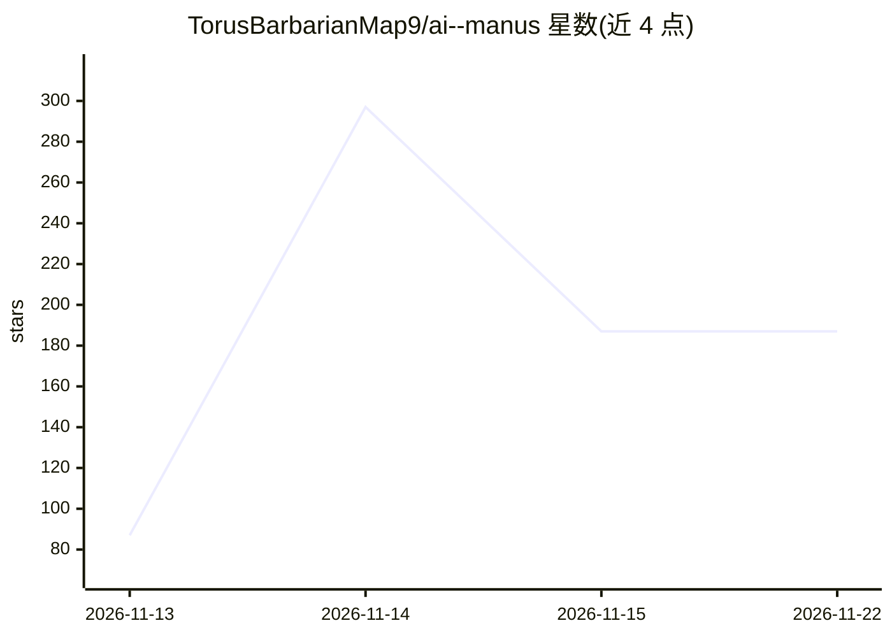

# TorusBarbarianMap9/ai--manus

⭐ 187 · Apache-2.0 · 推送 2026-11-15 · [GitHub](https://github.com/TorusBarbarianMap9/ai--manus) · 个人维护

**自主 AI Agent：代用户执行代码并控制浏览器完成任务**

README 描述的自主 AI Agent 系统，宣称可在沙盒环境中运行工具与操作：自行编写并执行脚本、控制浏览器导航网页与填写表单、执行多步骤任务，面向个人学习、家庭项目与轻量办公场景。README 标注需在后台持续运行，给出最低 4 GB 内存的兼容性表格。注意：全文为功能宣传式描述，未提供任何安装命令、源码结构、依赖说明或技术实现细节，仓库实际内容无法从 README 验证。

## 筛选速览

| 维度 | 判定 | 备注 |
|---|---|---|
| AI 角色 | `ai-native` | 本体是模型或模型工具 |
| 许可风险 | `permissive` | Apache-2.0 |
| 部署形态 | `None` |  |
| 模型依赖 | — | README 未给出锁定关系 |
| 硬件要求 | — | 无带数字的原话,不猜 |
| 安装摩擦 | `low` | 无编译、无系统依赖或容器化 |
| 成熟度 | — | 结构信号不足 |

## 能力要点

- 宣称支持自主代码执行与浏览器控制
- 面向多步骤任务，脚本与浏览器操作可在同一流程中衔接
- 以个人助手形式在后台待命

## 适用场景

- 让 Agent 代为执行网页信息收集与表单填写
- 自动运行小脚本完成重复性任务
- 学习与家庭项目中的日常自动化

## 场景标签

`AI 助手` `浏览器自动化` · 领域:效率与自动化

## 证据(README 行号)

> L10: - **Autonomous Code Execution:** Manus AI agent runs code on its own to complete tasks, so you can focus on decisio
> L18: Manus is an autonomous AI agent designed to run code and control a browser on your behalf. Instead of acting like a

## 星数曲线

2026-11-13 87 → 2026-11-22 187（+100）

---
*卡片 v1 · prompt 1.4 · 生成 2026-11-17 · 置信度 low · 依据 README sha `0f78ee3a5dd2` · [字段定义](../../DATASET.md)*
