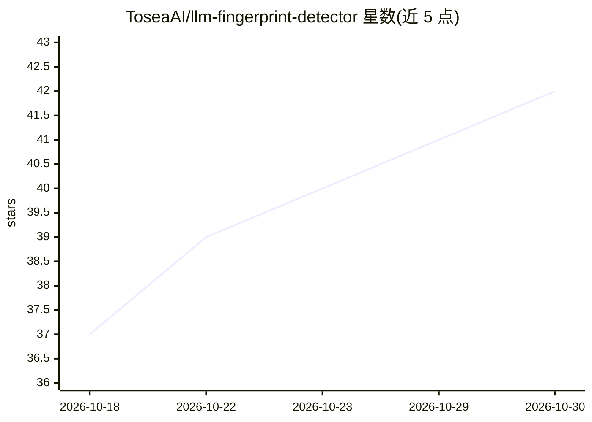

# ToseaAI/llm-fingerprint-detector

⭐ 42 · TypeScript · MIT · 推送 2026-07-21 · [GitHub](https://github.com/ToseaAI/llm-fingerprint-detector) · [官网](https://tosea.ai/free-tools/llm-api-fingerprint-checker) · 组织维护

**核验 OpenAI 兼容 API 实际服务哪个 LLM 的指纹检测库**

论文 'One Token Is Enough' 的独立 TypeScript 实现，以库 + CLI 形式提供：对任意 OpenAI 兼容端点发送约 100-400 个单词补全探针，采集单 token 输出分布作为行为指纹，用逐格 Jensen-Shannon 散度与可信参考比对，输出 match/uncertain/mismatch 判定，用于发现模型替换、量化或服务端提示注入。零运行时依赖，仅需 Node ≥ 18.17，附 11 个模型样本参考，支持 CI 退出码与 API key 环境变量读取。限制：指纹随模型更新漂移、依赖可信参考、单次判定为统计证据而非证明。

## 筛选速览

| 维度 | 判定 | 备注 |
|---|---|---|
| AI 角色 | `ai-ecosystem` | LLM/agent 周边工具 |
| 许可风险 | `permissive` | MIT |
| 部署形态 | `library` | 以包/库形式分发 |
| 模型依赖 | — | README 未给出锁定关系 |
| 硬件要求 | — | 无带数字的原话,不猜 |
| 安装摩擦 | `low` | 无编译、无系统依赖或容器化 |
| 成熟度 | — | 结构信号不足 |

## 能力要点

- 单 token 输出分布行为指纹，无需 logits/权重/特权访问
- 逐格 Jensen-Shannon 散度比对，三段式判定与 CI 友好退出码
- 零运行时依赖（Node ≥ 18.17 内置 fetch），库 + CLI 双形态
- 内置 11 个流行模型的样本参考指纹

## 适用场景

- 核验转售商/网关 API 是否真的在服务所声称的模型
- 在 CI 中自动检测模型替换或静默量化
- 比对不同提供方部署的同一模型行为一致性

## 场景标签

`网络安全` · 领域:学习与行业

## 证据(README 行号)

> L8: **Is that API really serving the model it claims?** Fingerprint and verify any OpenAI-compatible LLM endpoint from s
> L18: - **Library + CLI** — embed it, or run `llm-fingerprint verify` in CI

## 星数曲线

2026-10-18 37 → 2026-10-30 42（+5）

---
*卡片 v1 · prompt 1.4 · 生成 2026-10-25 · 置信度 high · 依据 README sha `61e31cdf2b79` · [字段定义](../../DATASET.md)*
