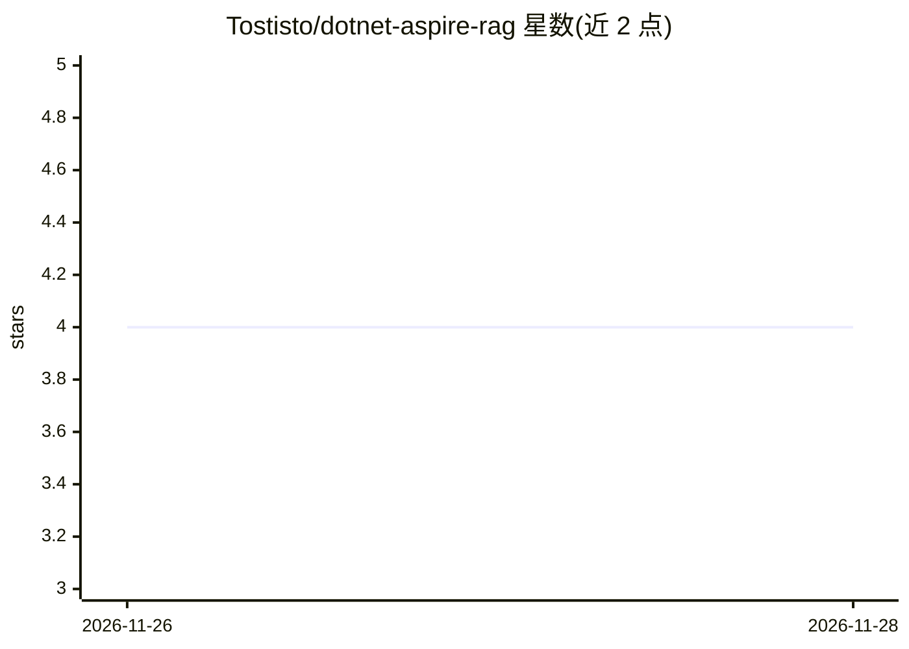

# Tostisto/dotnet-aspire-rag

⭐ 4 · C# · 推送 2026-11-23 · [GitHub](https://github.com/Tostisto/dotnet-aspire-rag) · 个人维护

**.NET Aspire 演示：本地模型对 Markdown 文档做 RAG 问答**

基于 .NET 10 与 Clean Architecture 的检索增强生成演示，由 Aspire 编排多个服务。启动时 ingestion worker 将 Markdown 页面分块、用 nomic-embed-text 生成嵌入并存入 Qdrant；提问经由 Microsoft Agent Framework（llama3.2:3b）驱动的 agent 检索 Qdrant 并仅依据检索结果作答，附引用页面。提供 Always/OnDemand 两种检索模式与原始搜索接口，运行依赖 .NET 10 SDK、Docker、Ollama 与 Aspire CLI，含单元与集成测试。

## 筛选速览

| 维度 | 判定 | 备注 |
|---|---|---|
| AI 角色 | `ai-native` | 本体是模型或模型工具 |
| 许可风险 | `none` | — |
| 部署形态 | `None` |  |
| 模型依赖 | local-ok | 支持本地模型 |
| 硬件要求 | — | 无带数字的原话,不猜 |
| 安装摩擦 | `medium` | 含编译或系统依赖之一 |
| 成熟度 | — | 结构信号不足 |

## 能力要点

- 分块→nomic-embed-text 嵌入→Qdrant 存储的摄取流程
- Agent 仅依据检索结果作答并引用来源页面
- Always/OnDemand 两种检索模式与 GET /api/search 原始检索接口
- 分层架构：Application 层不含 AI 或厂商包

## 适用场景

- 本地运行对自有 Markdown 文档集做带引用的问答
- 研究 Aspire 多服务编排与 .NET 下的 RAG 实现
- 查看分层架构中 AI 依赖隔离的组织方式

## 场景标签

`RAG` · 领域:知识与检索

## 证据(README 行号)

> L3: A small .NET 10 demo of retrieval-augmented generation with an AI agent, orchestrated by Aspire and built with Clean
> L9: On startup the ingestion worker splits every page into chunks, embeds them with `nomic-embed-text` and stores them i

## 星数曲线

2026-11-26 4 → 2026-11-28 4（+0）

---
*卡片 v1 · prompt 1.4 · 生成 2026-11-26 · 置信度 high · 依据 README sha `16e99c378322` · [字段定义](../../DATASET.md)*
