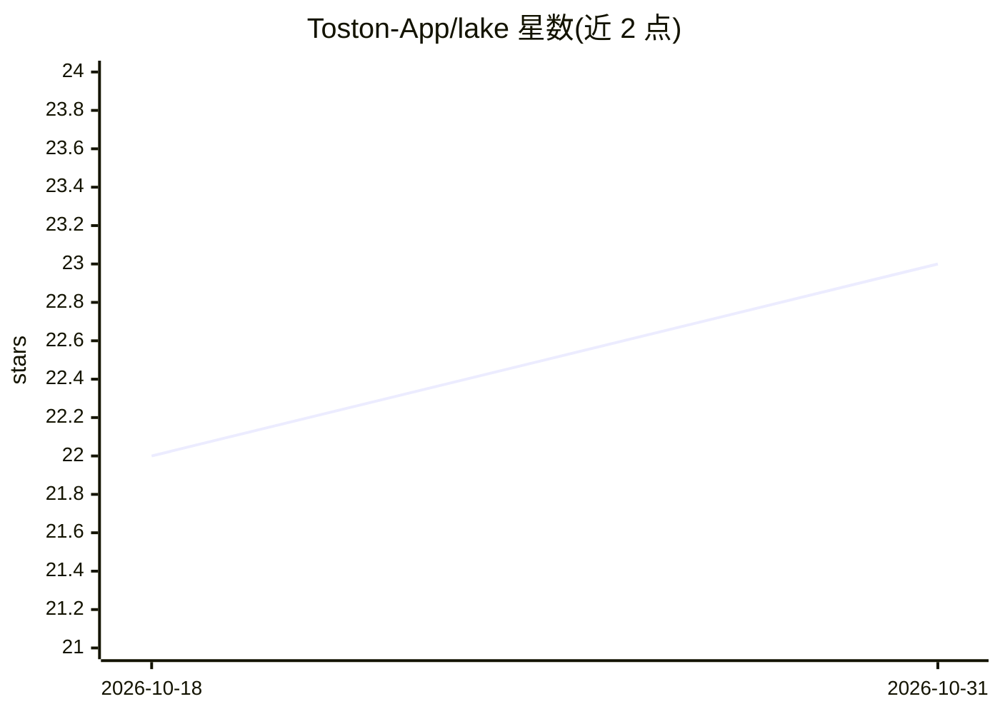

# Toston-App/lake

⭐ 23 · Python · AGPL-3.0 · 推送 2026-10-21 · [GitHub](https://github.com/Toston-App/lake) · [官网](https://toston.app) · 组织维护

**开源个人财务管理器的后端，支持 WhatsApp 记账**

Toston（原 Cleverbill.ing）的 Python 后端：个人财务管理器，通过 WhatsApp 集成记录交易，支持支出、收入、转账追踪，按日/周/月/年生成报告，提供自定义分类、导入导出与 OpenAPI JSON Web API。README 标注 AI 驱动的洞察功能为 soon（尚未上线）。部署依赖 Docker、Docker Compose 与 uv，通过 docker-compose 启动完整栈，内含 PostgreSQL、PGAdmin、Swagger UI 与可观测性面板，数据库迁移使用 Alembic。

## 筛选速览

| 维度 | 判定 | 备注 |
|---|---|---|
| AI 角色 | `ai-enhanced` | 去掉 AI 部分产品仍成立 |
| 许可风险 | `viral` | AGPL-3.0 |
| 部署形态 | `self-host` | docker 或自建部署 |
| 模型依赖 | — | README 未给出锁定关系 |
| 硬件要求 | — | 无带数字的原话,不猜 |
| 安装摩擦 | `low` | 无编译、无系统依赖或容器化 |
| 成熟度 | — | 结构信号不足 |

## 能力要点

- WhatsApp 集成记录交易
- 支出/收入/转账追踪与日/周/月/年报告
- 自定义分类与导入导出能力
- Docker Compose 一键启动完整栈，含 OpenAPI 文档与 PGAdmin

## 适用场景

- 通过 WhatsApp 快速记录日常收支
- 自托管个人财务管理后端
- 按时间段与分类查看财务报告

## 场景标签

 · 领域:个人财务/应用后端

## 证据(README 行号)

> L4:  A free, open-source personal finance manager powered by AI
> L9: - 💬 WhatsApp integration for transaction recording
> L19: - 🤖 AI-powered insights // soon

## 星数曲线

2026-10-18 22 → 2026-10-31 23（+1）

---
*卡片 v1 · prompt 1.4 · 生成 2026-10-27 · 置信度 mid · 依据 README sha `7846f8aa3b38` · [字段定义](../../DATASET.md)*
