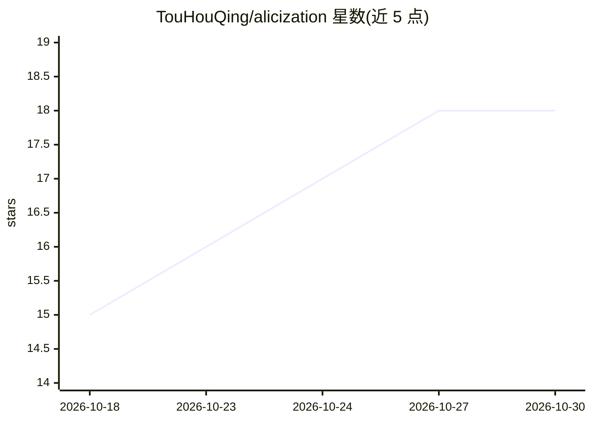

# TouHouQing/alicization

⭐ 18 · TypeScript · MIT · 推送 2026-10-16 · [GitHub](https://github.com/TouHouQing/alicization) · 个人维护 · 中文 README

**本地优先的桌面数字生命体：带记忆、人格与可控执行的 AI 伴侣**

基于大语言模型的本地优先自主数字生命体架构，以 Electron 桌面运行时（stage-tamagotchi）为主要载体。机制上以 SOUL.md 作为人格唯一事实源，SQLite 存储对话回合、记忆事实与审计日志；对话强制结构化 thought/emotion/reply 契约；工具调用经 MCP 权限门、工作区沙箱与 Kill Switch 控制；模型调用经 xsai 出网。已实现本地记忆与审计管线、潜意识 Tick、做梦整理等循环；视觉/语音等多模态仍在迭代，README 明确列出尚未完成的部分。为 AIRI 的 fork。

## 筛选速览

| 维度 | 判定 | 备注 |
|---|---|---|
| AI 角色 | `ai-native` | 本体是模型或模型工具 |
| 许可风险 | `permissive` | MIT |
| 部署形态 | `library` | 以包/库形式分发 |
| 模型依赖 | local-ok | 支持本地模型 |
| 硬件要求 | — | 无带数字的原话,不猜 |
| 安装摩擦 | `low` | 无编译、无系统依赖或容器化 |
| 成熟度 | `idea` | |

## 能力要点

- SOUL.md 单一人格事实源 + SQLite 结构化记忆与审计
- 工具调用经 MCP 权限门、工作区沙箱与 Kill Switch
- 潜意识 Tick 与做梦整理形成持续运行的后台循环
- 本地优先：截图/音频等缓存默认存本地路径

## 适用场景

- 在桌面构建并观察具有长期记忆与主动性的数字生命体
- 研究本地优先、可审计、可中断的 AI 伴侣架构
- 基于 Electron 实验人格契约、MCP 权限门控与执行沙箱

## 场景标签

`Agent 记忆` `AI 助手` · 领域:Agent 开发

## 证据(README 行号)

> L5: > Alicization (Artificial Labile Intelligent Cybernated Existence) is a **local-first autonomous digital entity arch
> L55: The main landing surface today is the Electron desktop runtime at `apps/stage-tamagotchi`.
> L69: |Vision, hearing, voice dialogue, and embodiment|Basic loops shipped, still being strengthened|Desktop presence, em

## 星数曲线

2026-10-18 15 → 2026-10-30 18（+3）

---
*卡片 v1 · prompt 1.4 · 生成 2026-10-29 · 置信度 high · 依据 README sha `822057e8cf4a` · [字段定义](../../DATASET.md)*
