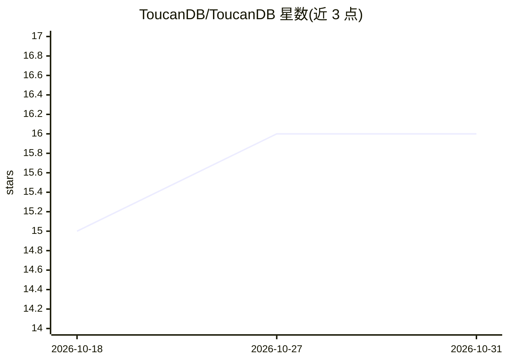

# ToucanDB/ToucanDB

⭐ 16 · Python · MIT · 推送 2026-09-19 · [GitHub](https://github.com/ToucanDB/ToucanDB) · [官网](https://PierreHenry.Dev) · 个人维护

**嵌入式本地向量数据库引擎，面向 RAG 与语义搜索**

以 Python 库形式提供的嵌入式、本地优先向量数据库：用 SQLite WAL 做原子持久化、FAISS 做向量索引（flat/HNSW/IVF），无需独立数据库服务器。内置无模型依赖的 RAG 管线（分块、命名空间隔离、来源归因、可注入生成器），并提供 Sentence Transformers/OpenAI 嵌入适配器。定位为嵌入组件而非分布式服务：单进程独占数据库目录，不自带 HTTP/认证/多租户；自述为 beta 阶段。适用桌面工具、本地 agent、私有 RAG 等。

## 筛选速览

| 维度 | 判定 | 备注 |
|---|---|---|
| AI 角色 | `ai-ecosystem` | LLM/agent 周边工具 |
| 许可风险 | `permissive` | MIT |
| 部署形态 | `library` | 以包/库形式分发 |
| 模型依赖 | — | README 未给出锁定关系 |
| 硬件要求 | — | 无带数字的原话,不猜 |
| 安装摩擦 | `low` | 无编译、无系统依赖或容器化 |
| 成熟度 | `idea` | |

## 能力要点

- SQLite 原子持久化 + FAISS 索引（flat/HNSW/IVF），无独立服务器
- 核心包内置 RAG 管线，不引入模型或框架依赖
- 可选认证加密与崩溃后确定性索引重建
- 异步 API 与数据库级 LRU 缓存预算

## 适用场景

- 桌面工具或本地 agent 中嵌入语义搜索能力
- 私有 RAG 场景下存储与检索向量，无需部署服务端
- 评测管线中做本地向量检索

## 场景标签

`向量数据库` `RAG` `语义搜索` · 领域:知识与检索

## 证据(README 行号)

> L3: **Store, index, and search high-dimensional vector embeddings. Built for RAG systems, semantic search, and LLM appli
> L11: An embedded, local-first vector database for semantic search, RAG, and
> L12: application memory. ToucanDB combines atomic SQLite persistence with FAISS

## 星数曲线

2026-10-18 15 → 2026-10-31 16（+1）

---
*卡片 v1 · prompt 1.4 · 生成 2026-10-30 · 置信度 high · 依据 README sha `9bda1788ecad` · [字段定义](../../DATASET.md)*
