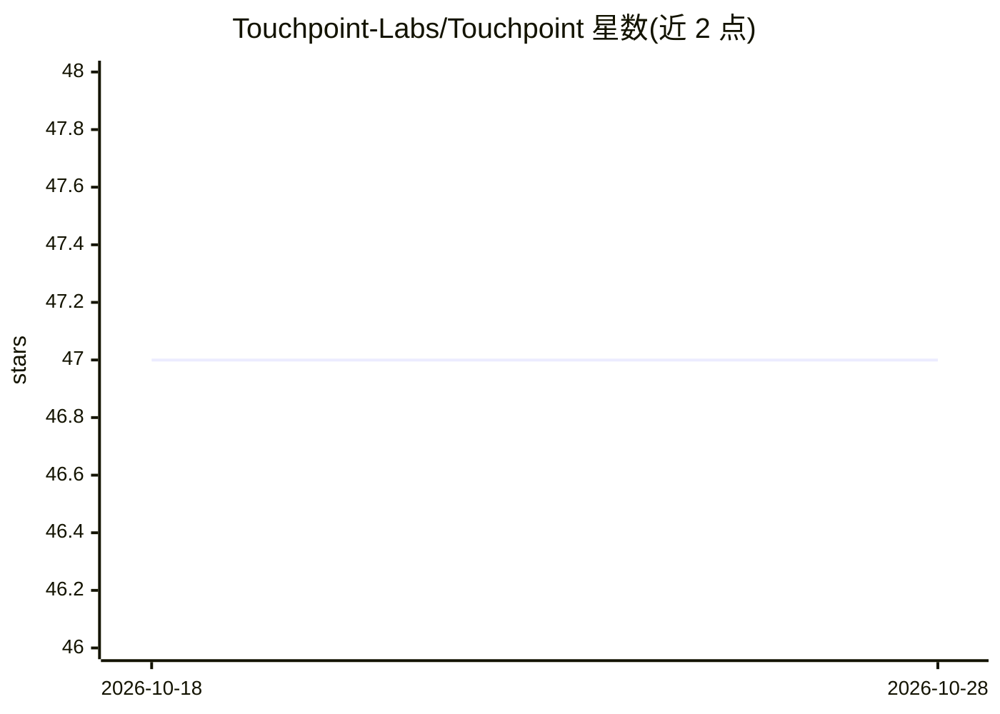

# Touchpoint-Labs/Touchpoint

⭐ 47 · Python · MIT · 推送 2026-06-08 · [GitHub](https://github.com/Touchpoint-Labs/Touchpoint) · 组织维护

**让 AI agent 通过无障碍 API 读取与操控桌面应用的 Python 库**

跨平台 Python 库，通过 Linux AT-SPI2、Windows UI Automation、macOS AX 原生无障碍 API 读取桌面 UI 元素（名称、角色、状态、位置），并提供点击、输入、窗口管理等操作函数。内置 CDP 后端获取 Chromium/Electron 应用的网页内容，并提供 MCP 服务器，使 Claude、Cursor、本地模型等 LLM agent 可控制桌面应用。支持 vision 与 no-vision 两种模式，后者以结构化文本树配合无视觉能力的模型。项目自标为 Alpha 阶段。

## 筛选速览

| 维度 | 判定 | 备注 |
|---|---|---|
| AI 角色 | `ai-ecosystem` | LLM/agent 周边工具 |
| 许可风险 | `permissive` | MIT |
| 部署形态 | `library` | 以包/库形式分发 |
| 模型依赖 | — | README 未给出锁定关系 |
| 硬件要求 | — | 无带数字的原话,不猜 |
| 安装摩擦 | `low` | 无编译、无系统依赖或容器化 |
| 成熟度 | `idea` | |

## 能力要点

- 一套 API 覆盖 Linux/macOS/Windows 原生无障碍树，无需视觉模型
- 内置 MCP 服务器，vision/no-vision 双模式适配含本地模型在内的 LLM
- CDP 后端读取 Chromium/Electron 应用网页内容并与原生结果合并
- 提供元素查找、四级匹配搜索、等待轮询与窗口管理函数集

## 适用场景

- 让 LLM agent 操控任意桌面应用完成自动化任务
- 用无视觉能力的本地模型通过结构化文本树操作桌面
- 统一读取原生应用与浏览器/Electron 应用的 UI 元素数据

## 场景标签

`GUI 自动化` · 领域:效率与自动化

## 证据(README 行号)

> L19: Touchpoint is a **cross-platform Python library** for reading and interacting with desktop UI through native access
> L21: Instead of scraping pixels or running vision models, Touchpoint reads the real accessibility tree — structured name
> L94: Touchpoint ships an MCP (Model Context Protocol) server ready for any MCP-compatible client. Use it to let LLM agen

## 星数曲线

2026-10-18 47 → 2026-10-28 47（+0）

---
*卡片 v1 · prompt 1.4 · 生成 2026-10-25 · 置信度 high · 依据 README sha `5ccc49b6c503` · [字段定义](../../DATASET.md)*
