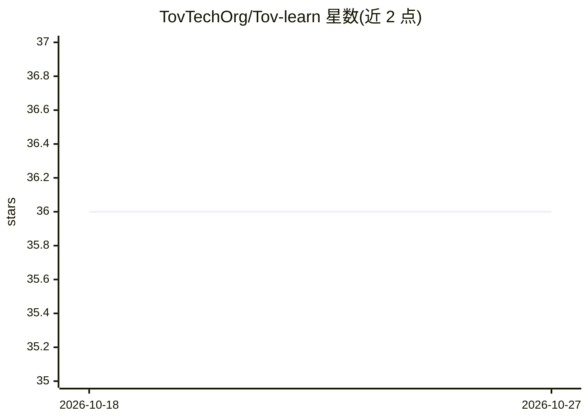

# TovTechOrg/Tov-learn

⭐ 36 · PowerShell · MIT · 推送 2026-09-29 · [GitHub](https://github.com/TovTechOrg/Tov-learn) · [官网](https://tovtech.org) · 组织维护

**基于 Claude Code 的交互式 AI 教学 skill，用间隔重复学习编程**

作为 Claude Code skill 运行的交互式 AI 家教：通过 /learn 命令启动课程，按模块编号浏览课程，教学采用 Journey Format（问题—洞察—项目关联—思考题），quiz 后按分数安排 2/13/34/89 天的间隔重复复习。支持智能续学（提示逾期复习课程）、HTML 可视化进度仪表盘、扫描学习者自己的项目生成架构图作为教学示例，以及可选 TTS 语音朗读。当前课程为 AI Dev，旧课程已归档。需要 Claude Code（Pro 及以上）。

## 筛选速览

| 维度 | 判定 | 备注 |
|---|---|---|
| AI 角色 | `ai-native` | 本体是模型或模型工具 |
| 许可风险 | `permissive` | MIT |
| 部署形态 | `None` |  |
| 模型依赖 | — | README 未给出锁定关系 |
| 硬件要求 | — | 无带数字的原话,不猜 |
| 安装摩擦 | `low` | 无编译、无系统依赖或容器化 |
| 成熟度 | — | 结构信号不足 |

## 能力要点

- 间隔重复复习调度（按 quiz 分数 2/13/34/89 天）
- 扫描学习者代码库生成可视化架构图并用作课程示例
- HTML 进度仪表盘（掌握中/进行中/未开始 + 分数）
- 支持希伯来语/英语与可选 TTS 朗读

## 适用场景

- 我想系统学习 AI 开发并有复习提醒
- 让导师用我自己正在做的项目解释概念
- 查看学习进度与待复习课程

## 场景标签

`教程课程` · 领域:学习与行业

## 证据(README 行号)

> L11: Interactive AI tutor, built as a Claude Code skill.
> L118: Every section is taught using the **Journey Format**:

## 星数曲线

2026-10-18 36 → 2026-10-27 36（+0）

---
*卡片 v1 · prompt 1.4 · 生成 2026-10-25 · 置信度 high · 依据 README sha `386366e1c307` · [字段定义](../../DATASET.md)*
