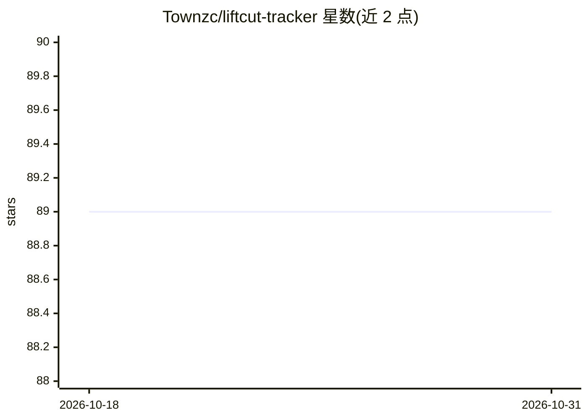

# Townzc/liftcut-tracker

⭐ 89 · Python · MIT · 推送 2026-10-28 · [GitHub](https://github.com/Townzc/liftcut-tracker) · [官网](https://www.liftcuttracker.com/) · 个人维护 · 中文 README

**开源健身/饮食/身体数据追踪应用，带确认制的 AI 计划生成**

双语 Web 应用，整合训练记录、饮食日志、身体测量与趋势图表，并附本地优先的访客模式、PDF 导出与 Supabase 账号迁移。AI 层生成训练与营养计划：模型输出经提取、规范化、严格校验后进入可编辑预览，仅在用户确认后保存；模型无写入工具，草稿绑定服务器签名。支持 DeepSeek、OpenAI 兼容接口与本地 vLLM 三种提供方模式。另含独立 Python 研究实验室（AgentLab），研究工具使用与 Qwen3-4B QLoRA 后训练，无需 GPU 或 API 即可运行。离线支持需页面已加载，无离线冷启动保证。

## 筛选速览

| 维度 | 判定 | 备注 |
|---|---|---|
| AI 角色 | `ai-enhanced` | 去掉 AI 部分产品仍成立 |
| 许可风险 | `permissive` | MIT |
| 部署形态 | `library` | 以包/库形式分发 |
| 模型依赖 | local-ok | 支持本地模型 |
| 硬件要求 | — | 无带数字的原话,不猜 |
| 安装摩擦 | `low` | 无编译、无系统依赖或容器化 |
| 成熟度 | — | 结构信号不足 |

## 能力要点

- 模型输出经结构化校验与可编辑预览，确认后才写入
- DeepSeek、OpenAI 兼容与本地 vLLM 三种提供方模式
- 本地优先访客模式，登录后可迁移数据到 Supabase
- 附带无需 GPU/API 的 Python AgentLab 研究管线

## 适用场景

- 记录训练、饮食与身体数据并查看趋势
- 让 AI 基于我的历史数据起草训练和营养计划再确认
- 不注册账号先试用双语演示

## 场景标签

 · 领域:健康健身/应用

## 证据(README 行号)

> L25: LiftCut brings workout completion, exercise performance, food logs, body trends, and AI-generated plans into one bi
> L51: > **Try it first:** the public beginner demo works without an account or AI key.

## 星数曲线

2026-10-18 89 → 2026-10-31 89（+0）

---
*卡片 v1 · prompt 1.4 · 生成 2026-10-23 · 置信度 mid · 依据 README sha `c04cfdcaae3f` · [字段定义](../../DATASET.md)*
