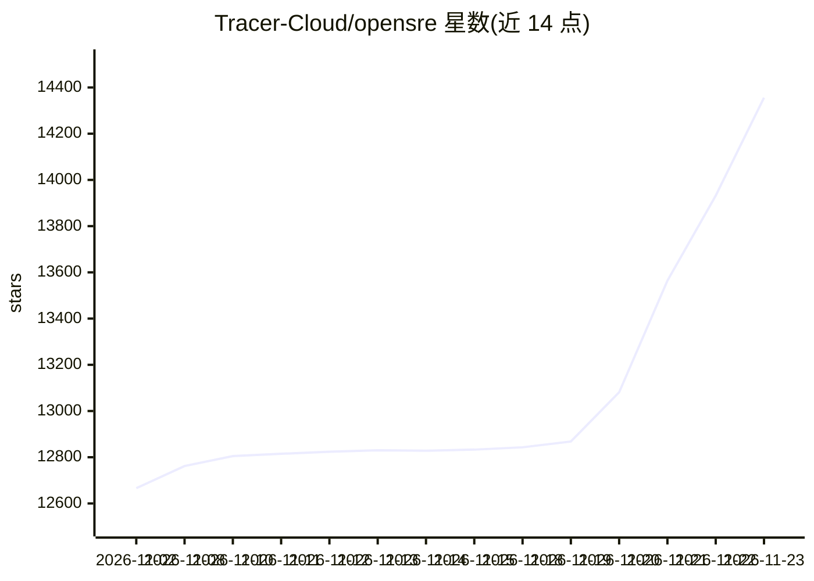

# Tracer-Cloud/opensre

⭐ 14,356 · Python · Apache-2.0 · 推送 2026-11-22 · [GitHub](https://github.com/Tracer-Cloud/opensre) · [官网](https://opensre.com) · 组织维护

**自托管的 CI/CD 可靠性 agent：诊断失败构建并推送修复**

OpenSRE 是一个 CLI 形态的开源 agent，针对 CI/CD 可靠性问题：CI 运行失败时读取失败检查与日志、检索提交与部署记录、关联日志/指标/链路，通过工具调用循环检验假设，区分 CI 原因与代码原因的失败，并可将修复推送到 PR 分支供人审查。工作流为获取上下文→脱敏→推理→回答→修复→把摘要发布到 Slack/PagerDuty/Telegram。除 CI 外也可接入 EKS、CloudWatch、Grafana、Datadog 等调查生产事故。提供交互式 shell、无头 CLI 与 Python API 三种使用方式，支持云端网关与自托管部署。当前为 public alpha。

## 筛选速览

| 维度 | 判定 | 备注 |
|---|---|---|
| AI 角色 | `ai-native` | 本体是模型或模型工具 |
| 许可风险 | `permissive` | Apache-2.0 |
| 部署形态 | `self-host` | docker 或自建部署 |
| 模型依赖 | local-ok | 支持本地模型 |
| 硬件要求 | — | 无带数字的原话,不猜 |
| 安装摩擦 | `low` | 无编译、无系统依赖或容器化 |
| 成熟度 | `idea` | |

## 能力要点

- 失败时自动调查：读取日志、检验假设、推送修复供审查
- 区分 CI 引起与代码引起的失败
- 交互式 shell、无头 CLI（opensre ask）、Python API 三种入口
- 接入 60+ 工具：可观测性、基础设施、数据库、事件管理

## 适用场景

- CI 构建Often变红时让 agent 自动定位原因并给出修复
- 用自然语言描述生产事故并让 agent 跨系统调查
- 统计 CI 失败率与 main 分支红色时长
- 把告警路由给 agent 自动响应并汇总到 Slack

## 场景标签

`编码 Agent` · 领域:编码与开发

## 证据(README 行号)

> L5:  Your CI tells you it broke, but not why or how to fix it. OpenSRE is a CLI agent that reads the failed run, traces 
> L70: When CI goes red, it tells you _that_ something failed, not _why_ or how to fix it. Under deadline pressure, teams 
> L151: When a CI run fails, an alert arrives, or you ask a question, OpenSRE automatically:

## 星数曲线

2026-11-02 12,666 → 2026-11-23 14,356（+1,690）

---
*卡片 v1 · prompt 1.4 · 生成 2026-11-23 · 置信度 high · 依据 README sha `e44c7688b79d` · [字段定义](../../DATASET.md)*
