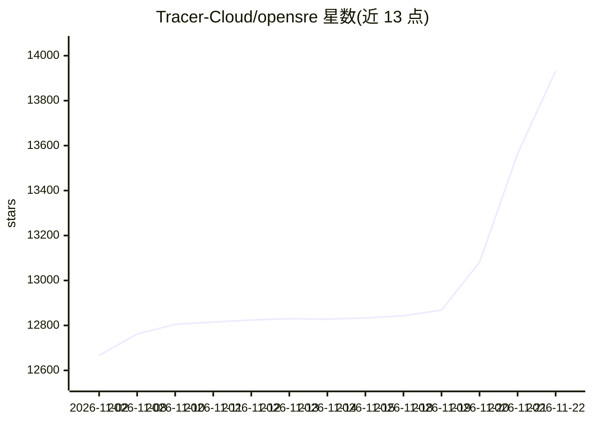

# Tracer-Cloud/opensre

⭐ 13,932 · Python · Apache-2.0 · 推送 2026-11-21 · [GitHub](https://github.com/Tracer-Cloud/opensre) · [官网](https://opensre.com) · 组织维护

**自托管 CLI 代理：自动排查 CI 失败原因并推送修复**

面向开发与运维团队的开源 CI/CD 可靠性代理（Apache 2.0，公共 alpha 阶段）。以 CLI 形式运行：读取失败的 CI 运行、拉取日志/提交/指标与追踪数据，在工具调用循环中推理并区分 CI 引发与代码引发的失败，随后推送修复到 PR 分支供人审阅，并可发送摘要至 Slack/PagerDuty/Telegram。支持 60+ 集成，涵盖 LLM 提供商、可观测性平台与基础设施。首次启动需账号登录激活托管模型；亦支持自托管网关与容器部署。

## 筛选速览

| 维度 | 判定 | 备注 |
|---|---|---|
| AI 角色 | `ai-native` | 本体是模型或模型工具 |
| 许可风险 | `permissive` | Apache-2.0 |
| 部署形态 | `self-host` | docker 或自建部署 |
| 模型依赖 | local-ok | 支持本地模型 |
| 硬件要求 | — | 无带数字的原话,不猜 |
| 安装摩擦 | `low` | 无编译、无系统依赖或容器化 |
| 成熟度 | `idea` | |

## 能力要点

- 失败 CI 运行自动取证→推理→推送修复到 PR 分支
- 区分 CI 引发与代码引发的失败
- 60+ 工具集成（LLM 提供商、可观测性、基础设施、事故管理）
- 交互式 REPL 与 headless CLI、Python API 三种使用方式

## 适用场景

- CI 挂了之后让代理自动排查根因并提交修复
- 统计 CI 失败率与 main 分支红置时长
- 把事故响应嵌入团队既有的 Python 服务与自动化流程

## 场景标签

`编码 Agent` `工作流自动化` · 领域:效率与自动化

## 证据(README 行号)

> L5:  Your CI tells you it broke, but not why or how to fix it. OpenSRE is a CLI agent that reads the failed run, traces 
> L70: When CI goes red, it tells you _that_ something failed, not _why_ or how to fix it. Under deadline pressure, teams 

## 星数曲线

2026-11-02 12,666 → 2026-11-22 13,932（+1,266）

---
*卡片 v1 · prompt 1.4 · 生成 2026-11-17 · 置信度 high · 依据 README sha `810e25735be3` · [字段定义](../../DATASET.md)*
