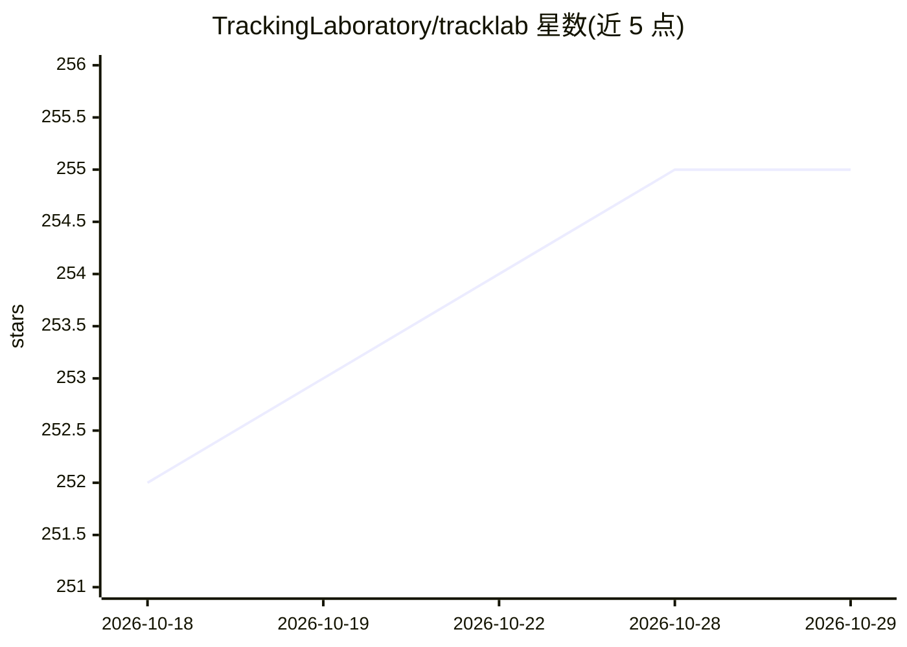

# TrackingLaboratory/tracklab

⭐ 255 · Python · MIT · 推送 2026-05-01 · [GitHub](https://github.com/TrackingLaboratory/tracklab) · [官网](https://trackinglaboratory.github.io/tracklab/) · 组织维护

**多目标（bbox/姿态）跟踪研究框架，模块化检测-ReID-跟踪流水线**

面向研究的模块化多目标跟踪框架，覆盖检测器（YOLO/YOLOX/RTMDet/RTDETR 等）、姿态估计器（RTMPose/RTMO/VITPose 等）、重识别模型（KPReID/BPBReID）与跟踪器（DeepSORT/StrongSORT/OC-SORT 等），各组件经 Hydra yaml 配置组合成流水线，支持在线与离线跟踪、在跟踪训练集上监督训练 ReID、多数据集与评测指标（MOTA/HOTA/IDF1）。以 pip/uv/conda 安装的 Python 包提供，README 自述库处于早期阶段。

## 筛选速览

| 维度 | 判定 | 备注 |
|---|---|---|
| AI 角色 | `ai-ecosystem` | LLM/agent 周边工具 |
| 许可风险 | `permissive` | MIT |
| 部署形态 | `library` | 以包/库形式分发 |
| 模型依赖 | — | README 未给出锁定关系 |
| 硬件要求 | — | 无带数字的原话,不猜 |
| 安装摩擦 | `medium` | 含编译或系统依赖之一 |
| 成熟度 | `idea` | |

## 能力要点

- 检测/姿态/ReID/跟踪组件模块化组合，Hydra yaml 配置
- 支持在线与离线跟踪（离线引擎批量推理）
- 支持在跟踪训练集上监督训练 ReID 模型
- 集成 TrackEval 评测（MOTA/HOTA/IDF1）

## 适用场景

- 在 DanceTrack/MOT17/SportsMOT 等数据集上跑通跟踪流水线
- 快速接入或自研检测/ReID/跟踪方法做研究
- 对比评测多种跟踪器指标

## 场景标签

`目标检测` `模型评测` · 领域:评测与运维

## 证据(README 行号)

> L31: Welcome to this official repository of TrackLab, a modular framework for multi-object tracking.
> L32: TrackLab is designed for research purposes and supports many types of detectors (bounding boxes, pose, segmentation
> L36: TrackLab is composed of multiple modules:

## 星数曲线

2026-10-18 252 → 2026-10-29 255（+3）

---
*卡片 v1 · prompt 1.4 · 生成 2026-10-22 · 置信度 high · 依据 README sha `cf79ed27c5d4` · [字段定义](../../DATASET.md)*
