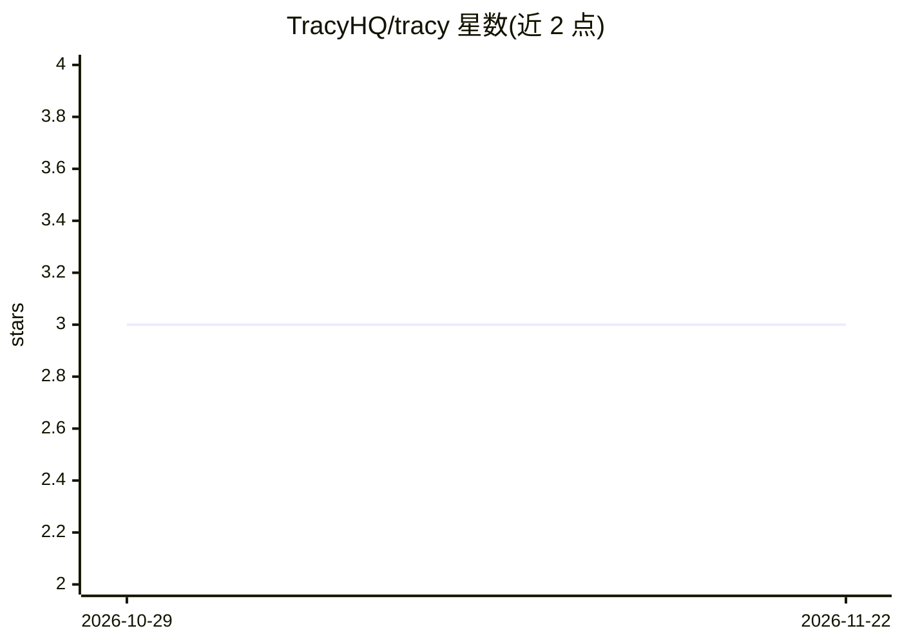

# TracyHQ/tracy

⭐ 3 · JavaScript · MIT · 推送 2026-11-21 · [GitHub](https://github.com/TracyHQ/tracy) · [官网](https://tracy.ai) · 组织维护 · 中文 README

**AI agent 编辑已上线 WordPress/Joomla/EmDash 网站的 CMS**

Tracy 是一个自托管的网站内容管理工具：用户填入已有 WordPress、Joomla 或 EmDash 站点地址，导入后在界面上点击任意区块、用一句话描述改动，由 AI agent 执行修改，每次改动可查看 diff、逐条撤销或整站备份恢复。同时提供模板建站、1,200+ 样式换肤、从业务简介生成页面、发布并绑定自有域名（HTTPS）功能。支持团队角色、区块评论、MCP 与 API 接入、8 种界面语言；桌面应用覆盖 macOS/Windows/Linux，另有 Web 版，处于 beta 阶段免费使用。

## 筛选速览

| 维度 | 判定 | 备注 |
|---|---|---|
| AI 角色 | `ai-enhanced` | 去掉 AI 部分产品仍成立 |
| 许可风险 | `permissive` | MIT |
| 部署形态 | `library` | 以包/库形式分发 |
| 模型依赖 | — | README 未给出锁定关系 |
| 硬件要求 | — | 无带数字的原话,不猜 |
| 安装摩擦 | `low` | 无编译、无系统依赖或容器化 |
| 成熟度 | `idea` | |

## 能力要点

- 点击区块+一句话改动，agent 修改真实站点且可审查与撤销
- 支持导入已有 WordPress/Joomla/EmDash 站点或从免费模板起步
- 变更列表记录来源（聊天/评论/后台/deploy）与 diff，支持备份恢复
- MCP 与 API 可从自有 agent 或脚本驱动 Tracy

## 适用场景

- 一句话修改已上线的 WordPress/Joomla 站点内容
- 代理机构为多个客户站点提供带角色的协作编辑
- 从业务简介快速生成可发布的站点并绑定域名

## 场景标签

`AI 助手` · 领域:对话与助手

## 证据(README 行号)

> L11:  A faster way to run your website on the CMS you already trust.
> L12:  Tell Tracy what you want in one sentence. Its AI agent edits the real site, and every change can be reviewed and u
> L74: - **MCP and API** — Drive Tracy from your own agent or scripts.

## 星数曲线

2026-10-29 3 → 2026-11-22 3（+0）

---
*卡片 v1 · prompt 1.4 · 生成 2026-11-22 · 置信度 low · 依据 README sha `08e4cef32362` · [字段定义](../../DATASET.md)*
