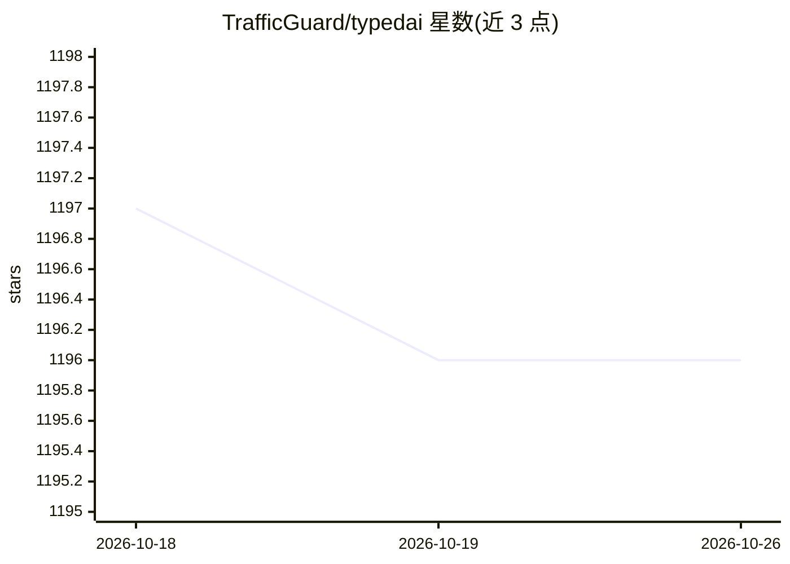

# TrafficGuard/typedai

⭐ 1,196 · TypeScript · MIT · 推送 2025-12-22 · [GitHub](https://github.com/TrafficGuard/typedai) · [官网](https://typedai.dev) · 组织维护

**TypeScript 开发者的 AI agent 与 LLM 工作流平台**

面向 TypeScript 开发者的 AI 平台，提供自主 agent、软件开发 agent（代码编辑、工单到 PR、代码审查）、聊天界面与 Slack 聊天机器人。支持 OpenAI、Anthropic、Gemini、Ollama 等多种 LLM 服务，LLM 函数调用 schema 可由源码装饰器自动生成，代码生成后沙箱执行。提供 CLI 与 Web UI，可本地运行、Docker 隔离运行或云端多用户 SSO 部署，内置 OpenTelemetry 可观测性。README 明确不使用 LangChain。

## 筛选速览

| 维度 | 判定 | 备注 |
|---|---|---|
| AI 角色 | `ai-ecosystem` | LLM/agent 周边工具 |
| 许可风险 | `permissive` | MIT |
| 部署形态 | `self-host` | docker 或自建部署 |
| 模型依赖 | local-ok | 支持本地模型 |
| 硬件要求 | — | 无带数字的原话,不猜 |
| 安装摩擦 | `low` | 无编译、无系统依赖或容器化 |
| 成熟度 | — | 结构信号不足 |

## 能力要点

- 自主 agent：迭代规划、分层任务分解、沙箱执行生成代码
- 软件开发 agent：代码编辑循环、工单到 PR 工作流、GitLab/GitHub 代码审查评论
- @func 装饰器从源码自动生成 LLM 函数调用 schema
- 支持多种 LLM 服务与 Human-in-the-loop 预算控制

## 适用场景

- 在 TypeScript 项目中构建和运行自主 agent 与 LLM 工作流
- 自动化代码编辑、工单到 PR 与合并请求代码审查
- 搭建带 SSO 与可观测性的多用户 AI 平台

## 场景标签

`Agent 框架` `编码 Agent` `代码审查` `聊天机器人` · 领域:Agent 开发

## 证据(README 行号)

> L13: TypedAI is a full-featured platform for developing and running agents, LLM based workflows and chatbots.
> L24: - Supports many LLM services - OpenAI, Anthropic (native & Vertex), Gemini, Groq, Fireworks, Together.ai, DeepSeek,

## 星数曲线

2026-10-18 1,197 → 2026-10-26 1,196（-1）

---
*卡片 v1 · prompt 1.4 · 生成 2026-10-21 · 置信度 high · 依据 README sha `22990c9f6642` · [字段定义](../../DATASET.md)*
