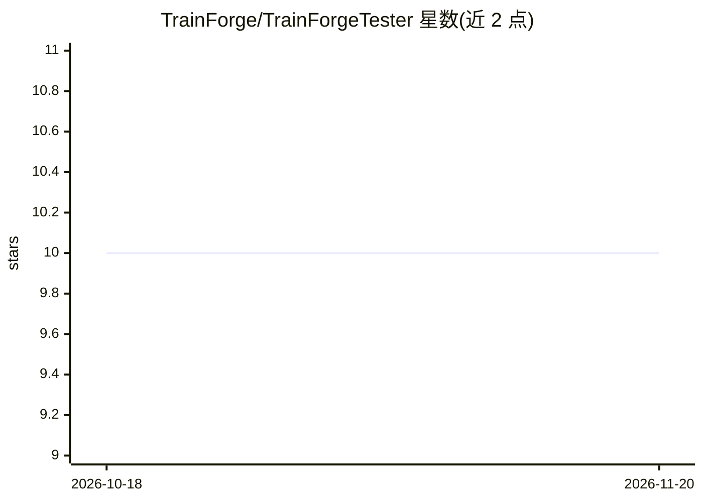

# TrainForge/TrainForgeTester

⭐ 10 · Python · NOASSERTION · 推送 2026-05-28 · [GitHub](https://github.com/TrainForge/TrainForgeTester) · [官网](https://trainforge.co) · 组织维护

**AI agent 回归测试工具：以确定性断言校验工具调用与回复**

以「确定性优先」方式对 AI agent 做回归测试的 CLI 与测试框架：场景以 JSON 定义，针对进程内 Python callable 或 HTTP endpoint 运行；工具调用与脚本化文本用 Python 等值断言检查，自由文本按每轮 20 个二元 NLP 一致性问句判定，不使用 0-1 质量评分。提供 run/record/report/diff/mock-agent 子命令、pytest 插件集成与 v1.x 迁移说明，要求 Python ≥ 3.10，许可证为 Apache 2.0。

## 筛选速览

| 维度 | 判定 | 备注 |
|---|---|---|
| AI 角色 | `ai-ecosystem` | LLM/agent 周边工具 |
| 许可风险 | `none` | NOASSERTION |
| 部署形态 | `library` | 以包/库形式分发 |
| 模型依赖 | — | README 未给出锁定关系 |
| 硬件要求 | — | 无带数字的原话,不猜 |
| 安装摩擦 | `low` | 无编译、无系统依赖或容器化 |
| 成熟度 | — | 结构信号不足 |

## 能力要点

- 工具调用与脚本化文本以 Python 等值断言检查，自由文本按每轮 20 个二元 NLP 一致性问句判定
- 支持进程内 Python callable 与 HTTP 两种传输方式，含 capture 模式与热切换 A/B 测试
- 提供 run/record/report/diff/mock-agent 子命令与 pytest 插件集成
- CI 中通过注入 stub LLM，不发起外部 LLM 调用

## 适用场景

- 在 CI 中对 agent 的工具调用与回复做回归测试
- 为同一 agent 的多个版本做 A/B 对比
- 定位哪条合同断言在测试中失败

## 场景标签

`模型评测` · 领域:评测与运维

## 证据(README 行号)

> L3: **Deterministic-first regression testing for AI agents.**
> L5: Scenarios run against your agent (in-process Python callable or HTTP
> L63: |CLI reference|Every subcommand (`run`, `record`, `report`, `diff`, `mock-agent`) and flag.|

## 星数曲线

2026-10-18 10 → 2026-11-20 10（+0）

---
*卡片 v1 · prompt 1.4 · 生成 2026-11-20 · 置信度 high · 依据 README sha `229a5ac0f391` · [字段定义](../../DATASET.md)*
