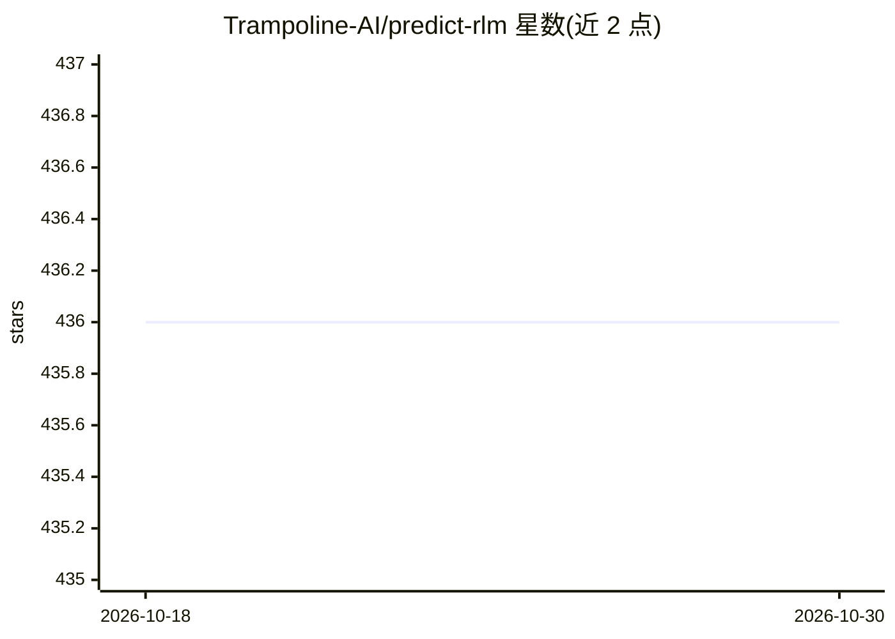

# Trampoline-AI/predict-rlm

⭐ 436 · Python · MIT · 推送 2026-10-27 · [GitHub](https://github.com/Trampoline-AI/predict-rlm) · [官网](https://trampoline.ai) · 组织维护

**让 LLM 自主编排子模型与工具的递归语言模型运行时**

基于 MIT CSAIL 递归语言模型（RLM）论文的 Python 运行时：开发者用 DSPy 签名定义输入、输出与工具，外层模型在沙箱化 REPL 中自行编写并执行 Python，按需调用类型化的子模型（predict()）、维护状态与分支，并返回结构化输出。每次运行记录完整轨迹（代码、工具调用、子调用、token 用量），轨迹可导出并供 GEPA 做策略优化。原生支持 openai/anthropic/gemini/moonshot/openrouter 路由（DSPy lm15 引擎），可选 Docker Sandboxes 后端。面向需要探索与自适应的复杂文档/代码/数据工作流，不适用于简单单次调用。

## 筛选速览

| 维度 | 判定 | 备注 |
|---|---|---|
| AI 角色 | `ai-ecosystem` | LLM/agent 周边工具 |
| 许可风险 | `permissive` | MIT |
| 部署形态 | `library` | 以包/库形式分发 |
| 模型依赖 | locked-api |  |
| 硬件要求 | — | 无带数字的原话,不猜 |
| 安装摩擦 | `low` | 无编译、无系统依赖或容器化 |
| 成熟度 | — | 结构信号不足 |

## 能力要点

- 外层 LM 在沙箱 REPL 中自行编写执行 Python，自主控制流程
- predict() 派生类型化 DSPy 签名的子模型调用（含多模态）
- 每次运行输出可导出的完整轨迹（trace.json / evidence.json）
- 轨迹可接入 GEPA 做 RLM 策略优化

## 适用场景

- 对多份 PDF 做文档分析、PII 脱敏或合同比对并产出结构化报告
- 代码库调查、日志分析与事件证据收集
- 发票抽取到 Excel、脏数据转换等金融/表格工作流
- 让编码 agent 通过 /rlm 技能自动构建 RLM

## 场景标签

`Agent 框架` · 领域:Agent 开发

## 证据(README 行号)

> L10: **predict-rlm gives models a runtime for those workflows:** inspect files, keep
> L14: You define the inputs, outputs, tools, and operating procedure. The model writes
> L19: Based on the Recursive Language Models

## 星数曲线

2026-10-18 436 → 2026-10-30 436（+0）

---
*卡片 v1 · prompt 1.4 · 生成 2026-10-22 · 置信度 high · 依据 README sha `8e1b63d43f96` · [字段定义](../../DATASET.md)*
