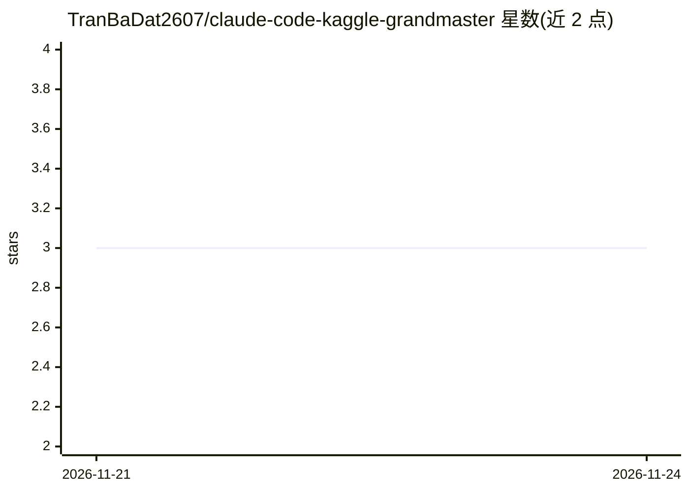

# TranBaDat2607/claude-code-kaggle-grandmaster

⭐ — · [GitHub]() · 个人维护

**Claude Code 插件：以 Kaggle 大师流程帮你打竞赛**

将 Claude Code 扩展为 Kaggle 竞赛协作助手的插件：从竞赛名一键生成防泄漏的交叉验证折、EDA、对抗性验证与基线，实验逐条记录并与基线逐折对比，集成时仅在同折预测上做爬坡与堆叠。内置 22 个 playbook 技能、19 个斜杠命令、9 个专家 agent 与 5 个安全 hook（拦截无效提交文件和会打印 Kaggle key 的命令），提供 kgkit Python 工具包与本地面板监控 Kaggle kernel 的 CPU/GPU/RAM 与配额。依赖 Python 3.9+、Kaggle CLI 与 API token。

## 筛选速览

| 维度 | 判定 | 备注 |
|---|---|---|
| AI 角色 | `ai-native` | 本体是模型或模型工具 |
| 许可风险 | `permissive` | — |
| 部署形态 | `library` | 以包/库形式分发 |
| 模型依赖 | — | README 未给出锁定关系 |
| 硬件要求 | — | 无带数字的原话,不猜 |
| 安装摩擦 | `low` | 无编译、无系统依赖或容器化 |
| 成熟度 | — | 结构信号不足 |

## 能力要点

- 冻结 CV 折与防泄漏校验，hook 拦截无效提交与泄露 key 的命令
- /kg-gpu 在 Kaggle 免费 GPU/TPU 上运行本地训练脚本并管理周配额
- kaggle-monitor 面板实时显示 kernel 资源、会话时限与提交分数
- 实验台账记录每次运行的命令与代码来源，结束后生成 showcase 仓库

## 适用场景

- 从零开始参加表格、CV、NLP、时序等 Kaggle 竞赛
- 给已有竞赛仓库接入可复现的实验与集成流程
- 把本地训练脚本托管到 Kaggle 免费 GPU 并监控运行

## 场景标签

`编码 Agent` · 领域:编码与开发

## 证据(README 行号)

> L9: Claude Code plugin
> L23: - **It catches the mistakes that cost medals.** Leakage across folds, tuning on the public LB, blending predictions

## 星数曲线

2026-11-21 3 → 2026-11-24 3（+0）

---
*卡片 v1 · prompt 1.4 · 生成 2026-11-22 · 置信度 mid · 依据 README sha `c6115f8c8215` · [字段定义](../../DATASET.md)*
