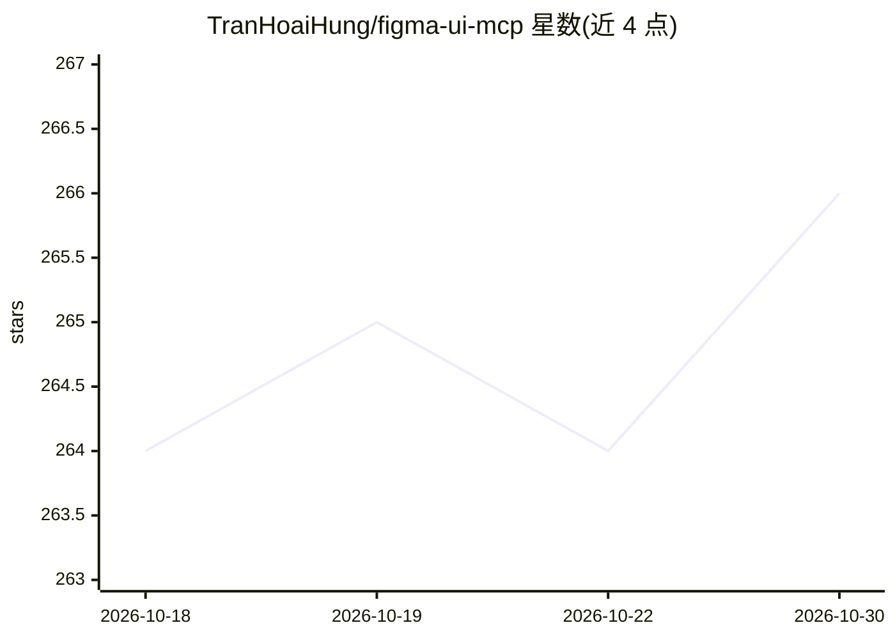

# TranHoaiHung/figma-ui-mcp

⭐ 266 · JavaScript · MIT · 推送 2026-10-26 · [GitHub](https://github.com/TranHoaiHung/figma-ui-mcp) · 个人维护

**让 AI 客户端直接在 Figma 画布绘制 UI 的 MCP 桥**

双向 Figma MCP 桥接服务：通过 MCP stdio 协议接入 Claude Code、Cursor、VS Code、Windsurf、Antigravity 等 AI 客户端，AI 可经 figma_write 在 Figma 画布绘制帧、形状、文本与原型，或经 figma_read 读取节点树、颜色、字体、截图与 CSS。架构为 MCP 服务器在 localhost:38451 起 HTTP 服务，Figma Desktop 内插件以长轮询通信，无需 Figma API key；多文件会话路由、VM 沙箱与 56 项操作白名单限制执行。面向使用 AI IDE 做 UI 设计与设计转代码的开发者。

## 筛选速览

| 维度 | 判定 | 备注 |
|---|---|---|
| AI 角色 | `ai-ecosystem` | LLM/agent 周边工具 |
| 许可风险 | `permissive` | MIT |
| 部署形态 | `desktop` | 安装包/桌面程序 |
| 模型依赖 | — | README 未给出锁定关系 |
| 硬件要求 | — | 无带数字的原话,不猜 |
| 安装摩擦 | `low` | 无编译、无系统依赖或容器化 |
| 成熟度 | — | 结构信号不足 |

## 能力要点

- figma_write 经 JS 在画布创建/修改 UI，figma_read 提取节点树、CSS、截图
- get_design_context 产出面向 React/Vue/Swift 代码生成的优化数据
- localhost 双向桥接，无需 Figma API key，支持多 Figma 文件会话
- VM 沙箱 + 56 项操作白名单 + localhost 绑定的安全层

## 适用场景

- 用自然语言让 AI 在 Figma 中绘制登录页、仪表盘等界面
- 读取现有 Figma 设计并转换为 Tailwind CSS 或组件代码
- 生成设计系统规则表（tokens、字体、组件目录）供 AI 会话使用

## 场景标签

`代码生成` · 领域:编码与开发

## 证据(README 行号)

> L15: **Bidirectional Figma MCP bridge** — let AI assistants (Claude Code, Cursor, Windsurf, Antigravity, VS Code Copilot
> L20: Claude ──figma_write──▶ MCP Server ──HTTP (localhost:38451)──▶ Figma Plugin ──▶ Figma Document
> L21: Claude ◀─figma_read──── MCP Server ◀──HTTP (localhost:38451)── Figma Plugin ◀── Figma Document

## 星数曲线

2026-10-18 264 → 2026-10-30 266（+2）

---
*卡片 v1 · prompt 1.4 · 生成 2026-10-22 · 置信度 high · 依据 README sha `29aab2d511c1` · [字段定义](../../DATASET.md)*
