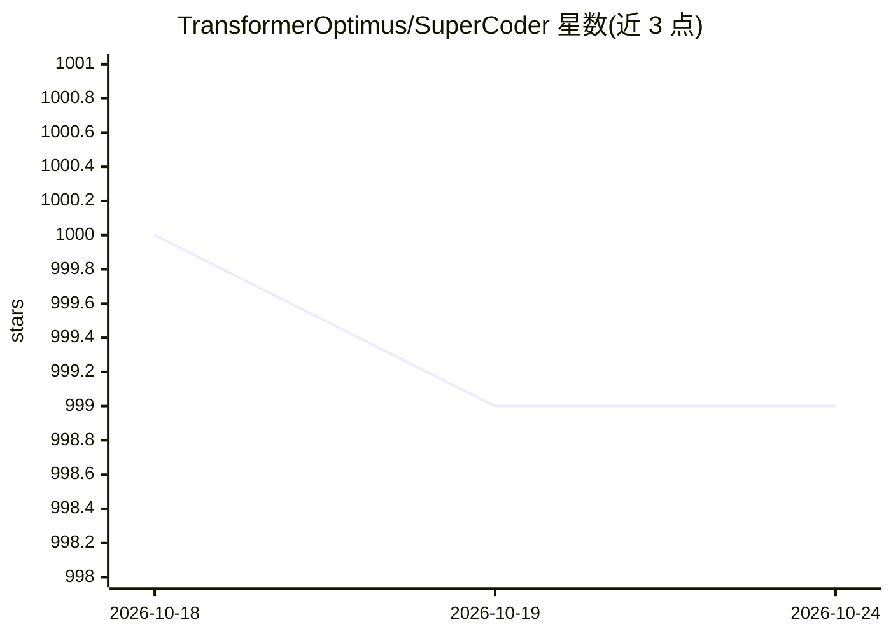

# TransformerOptimus/SuperCoder

⭐ 999 · Rust · MIT · 推送 2026-07-07 · [GitHub](https://github.com/TransformerOptimus/SuperCoder) · [官网](https://superagi.com) · 个人维护

**本地优先的开源桌面 AI 编程助手，自带 LLM key 使用**

基于 Rust agent 核心（crates/agent）与 Tauri 2 桌面应用的编程助手：支持 OpenAI chat-completions 与 Anthropic Messages API，用户自带 key 直连模型提供方，无中间服务。提供 Ask/Plan/Coding 模式、子代理、技能、工具审批、提示缓存、检查点与 diff 审查、交互式终端。可选 Context Engine 通过 Docker Compose 本地运行，用 tree-sitter、向量检索、调用图与 BM25 做仓库级代码检索。目前需从源码构建，预编译二进制尚未发布；2024 版自主开发管线已冻结于 v1/ 不再维护。

## 筛选速览

| 维度 | 判定 | 备注 |
|---|---|---|
| AI 角色 | `ai-ecosystem` | LLM/agent 周边工具 |
| 许可风险 | `permissive` | MIT |
| 部署形态 | `self-host` | docker 或自建部署 |
| 模型依赖 | — | README 未给出锁定关系 |
| 硬件要求 | — | 无带数字的原话,不猜 |
| 安装摩擦 | `low` | 无编译、无系统依赖或容器化 |
| 成熟度 | `idea` | |

## 能力要点

- 原生支持 OpenAI 与 Anthropic API，自带 key 直连，无中间代理
- Rust agent 核心：Ask/Plan/Coding 模式、子代理、工具审批、提示缓存
- 可选 Context Engine（Docker Compose 本地运行）：向量+调用图+BM25 仓库级检索
- 检查点/回退、diff 审查、交互式终端与文件浏览器

## 适用场景

- 在桌面本地使用 AI 代理编写与修改代码，代码不出本机
- 在大规模代码库中做结构化的代码定位与理解
- 配置自有 LLM key 按需切换模型提供方

## 场景标签

`编码 Agent` · 领域:编码与开发

## 证据(README 行号)

> L3: A local-first, open-source coding agent for your desktop. Bring your own LLM
> L20: - **Bring your own model.** The agent speaks the **OpenAI chat-completions** and
> L25: - **A real harness underneath.** The core is a pure-Rust agent crate with

## 星数曲线

2026-10-18 1,000 → 2026-10-24 999（-1）

---
*卡片 v1 · prompt 1.4 · 生成 2026-10-21 · 置信度 mid · 依据 README sha `86085a028c09` · [字段定义](../../DATASET.md)*
