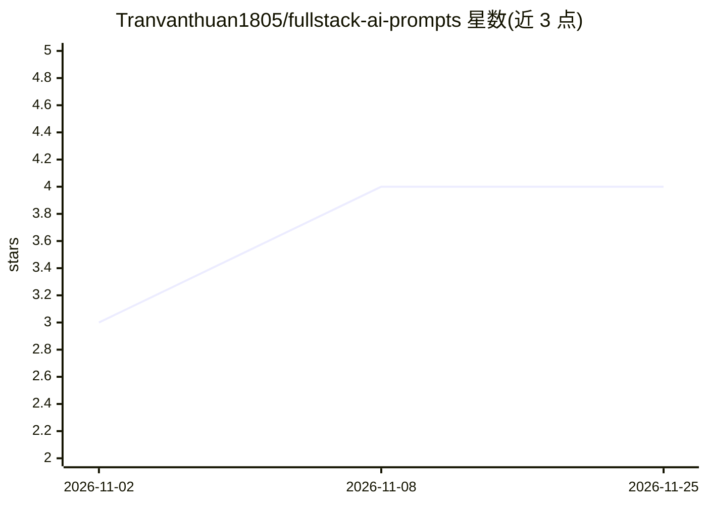

# Tranvanthuan1805/fullstack-ai-prompts

⭐ 4 · MIT · 推送 2026-11-02 · [GitHub](https://github.com/Tranvanthuan1805/fullstack-ai-prompts) · 个人维护

**面向新手的越南语 Fullstack Web 开发 AI 提示词集合**

越南语提示词（prompt）库，收录面向 Web 全栈开发全流程的实战提示词，按 6 个阶段组织：需求与架构设计、数据库与 API 设计、前端 UI、后端业务、调试测试、部署上线；配套新手指南（指南）、速查表（速查表）、C-P-G-C-O 五段式提示词编写公式，以及一个 15 分钟待办应用示例项目。使用者复制提示词模板、填入项目信息后交给 Claude/Gemini/ChatGPT/Cursor 等 AI 工具协作开发。内容以 Markdown 文件形式提供，无安装与运行环节，采用 MIT 许可证（MIT License）。

## 筛选速览

| 维度 | 判定 | 备注 |
|---|---|---|
| AI 角色 | `ai-knowledge` | 知识聚合/清单类 |
| 许可风险 | `permissive` | MIT |
| 部署形态 | `None` |  |
| 模型依赖 | — | README 未给出锁定关系 |
| 硬件要求 | — | 无带数字的原话,不猜 |
| 安装摩擦 | `low` | 无编译、无系统依赖或容器化 |
| 成熟度 | — | 结构信号不足 |

## 能力要点

- 按网站开发 6 阶段组织的实战提示词清单
- C-P-G-C-O 五块提示词编写公式
- 面向零基础读者的新手指南与速查表
- 含 15 分钟待办应用示例项目

## 适用场景

- 零基础用 AI 协作从零搭建一个全栈网站
- 为 Web 项目各阶段挑选现成提示词模板
- 学习结构化提示词的编写方法

## 场景标签

`提示工程` · 领域:Agent 开发

## 证据(README 行号)

> L45: Dưới đây là liên kết trực tiếp đến từng prompt thực chiến. Bạn chỉ cần bấm vào, sao chép (copy) và điền thông tin d
> L80: ## 🎯 Công thức viết Prompt vàng: "Mô hình 5 Khối C-P-G-C-O"

## 星数曲线

2026-11-02 3 → 2026-11-25 4（+1）

---
*卡片 v1 · prompt 1.4 · 生成 2026-11-21 · 置信度 high · 依据 README sha `1e68882e96b9` · [字段定义](../../DATASET.md)*
