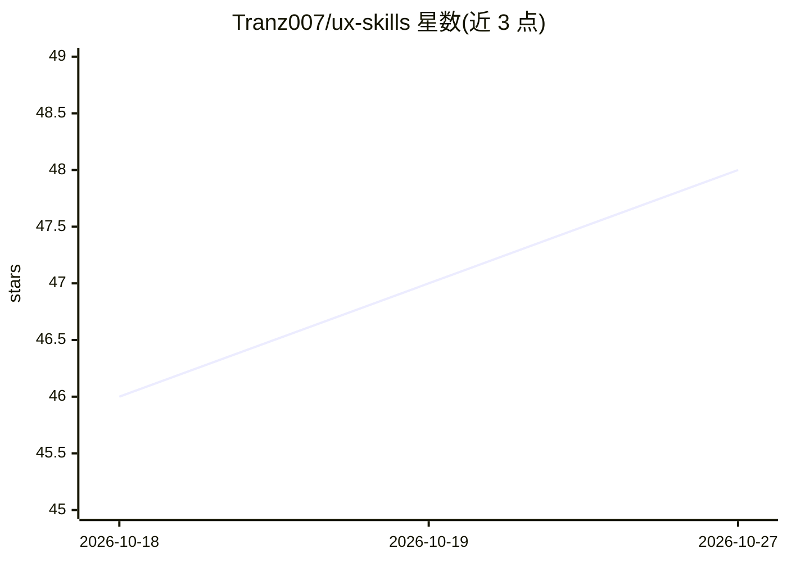

# Tranz007/ux-skills

⭐ 48 · Python · MIT · 推送 2026-09-04 · [GitHub](https://github.com/Tranz007/ux-skills) · 个人维护

**面向在职 UX 设计师的 Agent Skills 套件：让 AI 伙伴具备 UX 判断**

遵循开放 Agent Skills 格式的技能集合，安装到支持该格式的 AI agent（如 Claude Code、Cursor、Codex）中，为设计工作提供 UX 能力：通过 setup-ux 一次性建立 .ux/ 下四个上下文文件（INTENT/CONTEXT/DESIGN-SYSTEM/DECISIONS），之后 agent 依据自然语言自动路由到 15 个内部技能（挑战假设、盲点、状态检查、可访问性、设计系统复用、交接工程等）。设计者只需运行 setup-ux，无需学习技能菜单；强调证据纪律与渐进加载上下文，不自动生成空模板。以 npx skills add 命令安装。

## 筛选速览

| 维度 | 判定 | 备注 |
|---|---|---|
| AI 角色 | `ai-ecosystem` | LLM/agent 周边工具 |
| 许可风险 | `permissive` | MIT |
| 部署形态 | `library` | 以包/库形式分发 |
| 模型依赖 | — | README 未给出锁定关系 |
| 硬件要求 | — | 无带数字的原话,不猜 |
| 安装摩擦 | `low` | 无编译、无系统依赖或容器化 |
| 成熟度 | — | 结构信号不足 |

## 能力要点

- 15 个细分技能按自然语言自动路由（challenge/blindspots/accessibility/handoff 等）
- setup-ux 生成 4 个精简上下文文件，区分已知/推断/假设/未知
- 遵循开放 Agent Skills 格式，跨 agent 可移植，不绑定单一模型或设计工具
- 不强制 UX 流程：简单任务不引入 persona、研究或发现环节

## 适用场景

- 让 AI 编程伙伴在写界面前先质疑需求假设、找盲点
- 把产品设计意图与决策记录为文件，随工作传入工程
- 要求 agent 优先复用既有设计系统而非新造组件
- 为 PR 描述与设计-工程交接保留行为与无障碍意图

## 场景标签

`提示工程` · 领域:Agent 开发

## 证据(README 行号)

> L9: UX Skills is an open-source set of Agent Skills for working designers. It does not try to replace the designer or tu
> L169: UX Skills follows the open Agent Skills format. It is intended to work across agents that support the format rathe

## 星数曲线

2026-10-18 46 → 2026-10-27 48（+2）

---
*卡片 v1 · prompt 1.4 · 生成 2026-10-25 · 置信度 mid · 依据 README sha `13a9fc4b9be0` · [字段定义](../../DATASET.md)*
