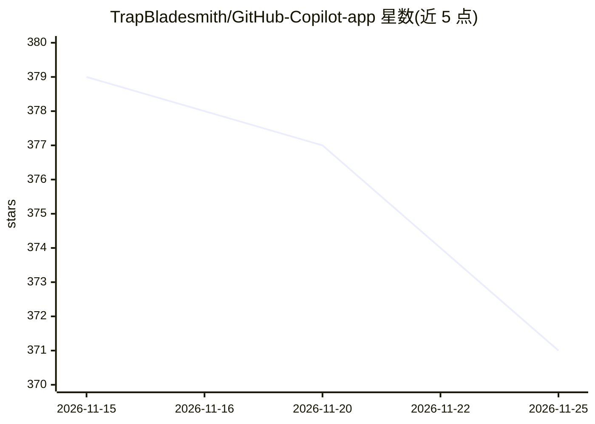

# TrapBladesmith/GitHub-Copilot-app

⭐ 371 · Apache-2.0 · 推送 2026-11-15 · [GitHub](https://github.com/TrapBladesmith/GitHub-Copilot-app) · 组织维护

**面向 GitHub 仓库的 Copilot 桌面端，代理并行开发工作台**

GitHub, Inc. 发布的桌面应用，用于查找、启动、引导并合并跨仓库的软件开发工作。本地会话运行在隔离的 git worktree，云端会话运行在 GitHub 托管的隔离环境中；提供 Canvas 可视化代理工作、My Work 聚合会话/issue/PR、自动化定时任务与 Agent Merge 协助走完评审与合并。前置要求为 Git 与任意 Copilot 订阅，无订阅可通过自带密钥（BYOK）接入自有模型提供商。通过 Releases 页下载安装。

## 筛选速览

| 维度 | 判定 | 备注 |
|---|---|---|
| AI 角色 | `ai-ecosystem` | LLM/agent 周边工具 |
| 许可风险 | `permissive` | Apache-2.0 |
| 部署形态 | `desktop` | 安装包/桌面程序 |
| 模型依赖 | — | README 未给出锁定关系 |
| 硬件要求 | — | 无带数字的原话,不猜 |
| 安装摩擦 | `low` | 无编译、无系统依赖或容器化 |
| 成熟度 | — | 结构信号不足 |

## 能力要点

- 本地会话各自隔离在独立 git worktree，支持代理并行工作
- Canvas 将计划、终端、预览、diff 呈现为可检查可编辑的界面
- 无 Copilot 订阅可 BYOK 接入自有模型提供商
- Automations 将重复提示与流程转为定时/后台任务

## 适用场景

- 并行驱动多个 Copilot 代理处理 bug 调查、issue 实现与评审修改
- 在单一控制台管理会话、issue 与 PR 决定下一步工作
- 用 Agent Merge 跟进 PR 的评审、检查与合并条件

## 场景标签

`编码 Agent` · 领域:编码与开发

## 证据(README 行号)

> L3: The GitHub Copilot app is an agent-native desktop experience for finding, running, steering, and landing software wo
> L13: The GitHub Copilot app is an agent-native desktop experience for managing software work from idea to pull request. 

## 星数曲线

2026-11-15 379 → 2026-11-25 371（-8）

---
*卡片 v1 · prompt 1.4 · 生成 2026-11-17 · 置信度 high · 依据 README sha `f4e4cad8cfa9` · [字段定义](../../DATASET.md)*
