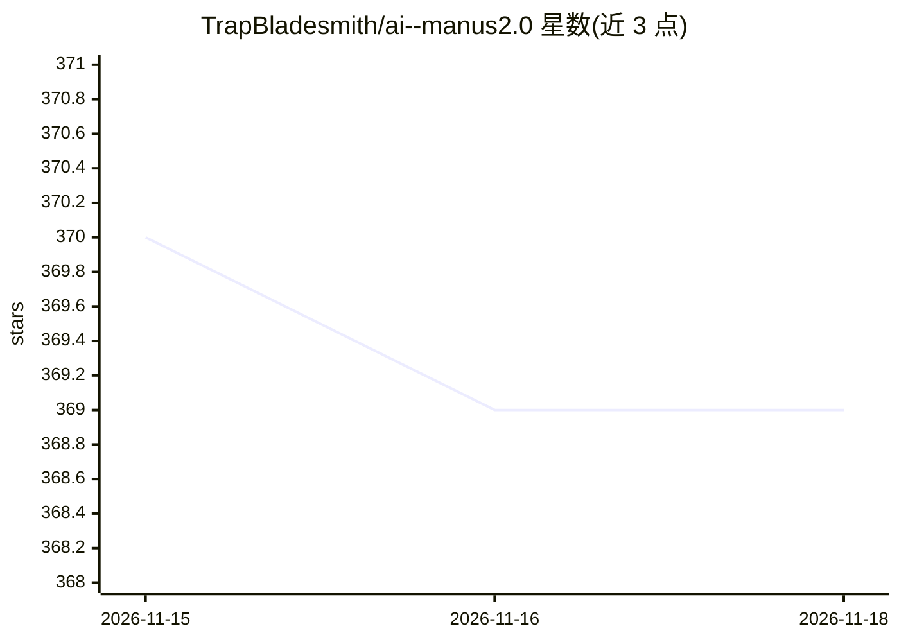

# TrapBladesmith/ai--manus2.0

⭐ 369 · Apache-2.0 · 推送 2026-11-15 · [GitHub](https://github.com/TrapBladesmith/ai--manus2.0) · 个人维护

**面向日常任务的自主 AI 代理：自动执行代码与浏览器操作**

README 描述一个名为 Manus 的自主 AI 代理，宣称可自行编写并执行脚本、控制浏览器（导航网页、填写表单、抓取信息），完成多步骤任务，定位为家庭、学习与轻量办公场景的个人助手。给出系统兼容性表（最低双核 CPU、4 GB 内存）与六步上手流程（准备、配置、测试、细化、应用、维护）。README 未提供任何安装命令、代码仓库结构、模型接入方式或 API 说明，技术实现细节缺失，仅有 L5 的“Download Manus”与促销码字样。

## 筛选速览

| 维度 | 判定 | 备注 |
|---|---|---|
| AI 角色 | `ai-native` | 本体是模型或模型工具 |
| 许可风险 | `permissive` | Apache-2.0 |
| 部署形态 | `None` |  |
| 模型依赖 | — | README 未给出锁定关系 |
| 硬件要求 | — | 无带数字的原话,不猜 |
| 安装摩擦 | `low` | 无编译、无系统依赖或容器化 |
| 成熟度 | — | 结构信号不足 |

## 能力要点

- 自主代码执行与浏览器控制结合的多步骤任务执行
- 会话间记忆工作流模式，可重复应用同一逻辑
- 面向非开发者：无需编程背景即可委派任务
- 给出最低/推荐硬件兼容性表

## 适用场景

- 让学生整理研究资料、运行小脚本
- 让代理跨多页面收集信息并准备摘要
- 远程技术支持中重排诊断步骤、检查系统页面

## 场景标签

`AI 助手` `浏览器自动化` · 领域:效率与自动化

## 证据(README 行号)

> L10: - **Autonomous Code Execution:** Manus AI agent runs code on its own to complete tasks, so you can focus on decisio
> L18: Manus is an autonomous AI agent designed to run code and control a browser on your behalf. Instead of acting like a

## 星数曲线

2026-11-15 370 → 2026-11-18 369（-1）

---
*卡片 v1 · prompt 1.4 · 生成 2026-11-17 · 置信度 low · 依据 README sha `71798a5b9c2b` · [字段定义](../../DATASET.md)*
