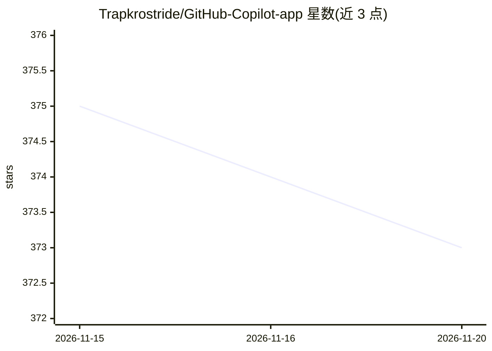

# Trapkrostride/GitHub-Copilot-app

⭐ 373 · Apache-2.0 · 推送 2026-11-15 · [GitHub](https://github.com/Trapkrostride/GitHub-Copilot-app) · 组织维护

**管理 GitHub Copilot agent 软件工作的桌面应用**

GitHub, Inc. 发布的桌面应用，用于跨仓库寻找、运行、引导和交付软件工作：本地会话运行于隔离的 git worktree，云会话在 GitHub 托管的隔离环境中运行 agent；Canvases 提供查看与编辑 agent 工作的可视化界面；My Work 汇聚会话、issue 与 PR，Automations 支持定时/后台任务，Agent Merge 辅助 PR 走完评审与合并。需 Git 与 Copilot 订阅，也支持自带密钥（BYOK）接入自选模型提供商。通过 Releases 页面下载安装包。仓库为公开主页，用于下载发布版、报 bug 与讨论。

## 筛选速览

| 维度 | 判定 | 备注 |
|---|---|---|
| AI 角色 | `ai-ecosystem` | LLM/agent 周边工具 |
| 许可风险 | `permissive` | Apache-2.0 |
| 部署形态 | `desktop` | 安装包/桌面程序 |
| 模型依赖 | — | README 未给出锁定关系 |
| 硬件要求 | — | 无带数字的原话,不猜 |
| 安装摩擦 | `low` | 无编译、无系统依赖或容器化 |
| 成熟度 | — | 结构信号不足 |

## 能力要点

- 本地会话各自运行在隔离 git worktree，支持并行 agent 开发
- Canvases 将 agent 计划、终端、diff 与工作流状态呈现为可编辑界面
- 无 Copilot 订阅时可通过 BYOK 使用自己的模型提供商
- Automations 将可重复提示与工作流转为定时或后台任务

## 适用场景

- 并行启动多个 Copilot agent 处理 bug、issue 与评审反馈
- 在统一界面中查看与接管 agent 的中间工作成果
- 通过 Agent Merge 跟踪 PR 的评审、检查与合并条件

## 场景标签

`编码 Agent` · 领域:编码与开发

## 证据(README 行号)

> L13: The GitHub Copilot app is an agent-native desktop experience for managing software work from idea to pull request. 
> L15: The app is built for parallel agent-driven development. Each local session runs in its own isolated git worktree, a

## 星数曲线

2026-11-15 375 → 2026-11-20 373（-2）

---
*卡片 v1 · prompt 1.4 · 生成 2026-11-17 · 置信度 high · 依据 README sha `f4e4cad8cfa9` · [字段定义](../../DATASET.md)*
