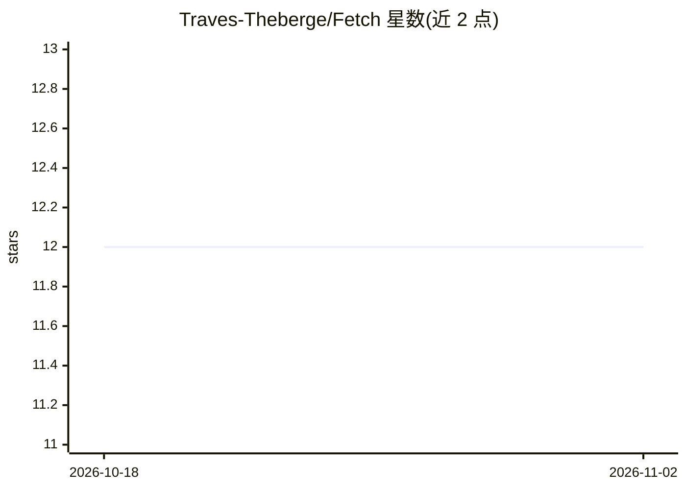

# Traves-Theberge/Fetch

⭐ 12 · TypeScript · MIT · 推送 2026-06-07 · [GitHub](https://github.com/Traves-Theberge/Fetch) · 个人维护

**WhatsApp 控制的自托管多智能体编码编排器**

Fetch 将 WhatsApp 消息作为入口，把编码任务分派到沙箱 Docker 容器内运行的 CLI harness（Copilot、Claude、Gemini、OpenCode、Codex），并提供 Go TUI 做主机侧运维。架构为三容器栈（bridge/kennel/searxng）加主机管理器。功能包括任务委派、工作流与 cron 编排、GitHub PR/issue/CI 操作、浏览器与网页工具、工作区与 git 管理；提供 OpenAI 向量嵌入+BM25 混合语义记忆、token 上下文压缩、无限工具循环自动熔断、自主级别策略门控与敏感参数脱敏。运行需 Docker、Node.js 20+、Go 1.21+ 及 OPENROUTER_API_KEY。

## 筛选速览

| 维度 | 判定 | 备注 |
|---|---|---|
| AI 角色 | `ai-ecosystem` | LLM/agent 周边工具 |
| 许可风险 | `permissive` | MIT |
| 部署形态 | `self-host` | docker 或自建部署 |
| 模型依赖 | locked-api |  |
| 硬件要求 | — | 无带数字的原话,不猜 |
| 安装摩擦 | `low` | 无编译、无系统依赖或容器化 |
| 成熟度 | — | 结构信号不足 |

## 能力要点

- 通过 WhatsApp 路由任务到 5 种 CLI 编码 harness（沙箱 Docker 内执行）
- 任务委派 / 工作流 / cron / GitHub / 浏览器 / 工作区六类工具集
- 语义记忆（向量嵌入+BM25）与 token 级上下文动态压缩
- 自主级别门控、敏感参数脱敏、/stop 等确定性安全命令

## 适用场景

- 在手机上通过 WhatsApp 远程指挥多个编码 CLI 智能体干活
- 为项目配置定时工作流跑测试并同步 GitHub
- 通过对话创建 PR、issue 并查看 CI 状态

## 场景标签

`多智能体` `编码 Agent` `工作流自动化` · 领域:Agent 开发

## 证据(README 行号)

> L12: Fetch is a self-hosted, multi-agent coding orchestrator controlled from WhatsApp.
> L13: It routes work to CLI harnesses (Copilot, Claude, Gemini, OpenCode, Codex) inside a sandboxed Docker container and 

## 星数曲线

2026-10-18 12 → 2026-11-02 12（+0）

---
*卡片 v1 · prompt 1.4 · 生成 2026-11-01 · 置信度 mid · 依据 README sha `c7bed552b103` · [字段定义](../../DATASET.md)*
