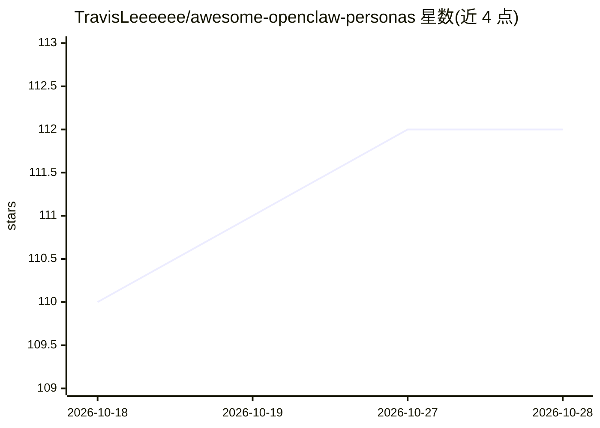

# TravisLeeeeee/awesome-openclaw-personas

⭐ 112 · 推送 2026-04-08 · [GitHub](https://github.com/TravisLeeeeee/awesome-openclaw-personas) · [官网](https://deskclaw.net) · 组织维护 · 中文 README

**面向 OpenClaw 的 214+ 个 AI agent 人格配置策展清单**

由 DeskClaw.net 维护并每周更新的 OpenClaw 人格（persona）策展仓库：收录 214 个人格配置包，覆盖 34 个类别（电商、营销、财务、工程、游戏开发等）。每个人格是一个由 SOUL.md、AGENTS.md、SKILL.md 等结构化文件组成的配置目录，含方法论、SOP、决策框架与输出模板；用户将目录复制进 OpenClaw 工作区即可让 agent 变为对应专家。使用方式为 git clone 获取，本身不含可运行代码。

## 筛选速览

| 维度 | 判定 | 备注 |
|---|---|---|
| AI 角色 | `ai-knowledge` | 知识聚合/清单类 |
| 许可风险 | `none` | — |
| 部署形态 | `None` |  |
| 模型依赖 | — | README 未给出锁定关系 |
| 硬件要求 | — | 无带数字的原话,不猜 |
| 安装摩擦 | `low` | 无编译、无系统依赖或容器化 |
| 成熟度 | — | 结构信号不足 |

## 能力要点

- 214 个人格配置，按 34 个类别组织，每周更新
- 每个人格含 SOUL.md/AGENTS.md/SKILL.md 等结构化文件与 SOP、决策矩阵、输出模板
- 使用方式为克隆仓库后复制人格目录到 OpenClaw 工作区

## 适用场景

- 为 OpenClaw agent 挑选电商、营销、工程等领域的现成人格
- 查阅某个专业方向（如跨境选品、投放审计）的 agent 工作流配置范例
- 了解 OpenClaw 人格生态的类别覆盖情况

## 场景标签

`精选清单` `提示工程` · 领域:Agent 开发

## 证据(README 行号)

> L12: > **214 ready-to-use AI agent personas for OpenClaw** — each one a complete specialist with real SOPs, decision fra
> L16: OpenClaw is an AI agent platform that turns large language models into autonomous assistants. A **persona** is a co
> L40: - **✅ Free & Open** — 214 curated personas across 34 categories, all open-source. Clone the repo, copy a directory,

## 星数曲线

2026-10-18 110 → 2026-10-28 112（+2）

---
*卡片 v1 · prompt 1.4 · 生成 2026-10-23 · 置信度 high · 依据 README sha `b304a983411d` · [字段定义](../../DATASET.md)*
