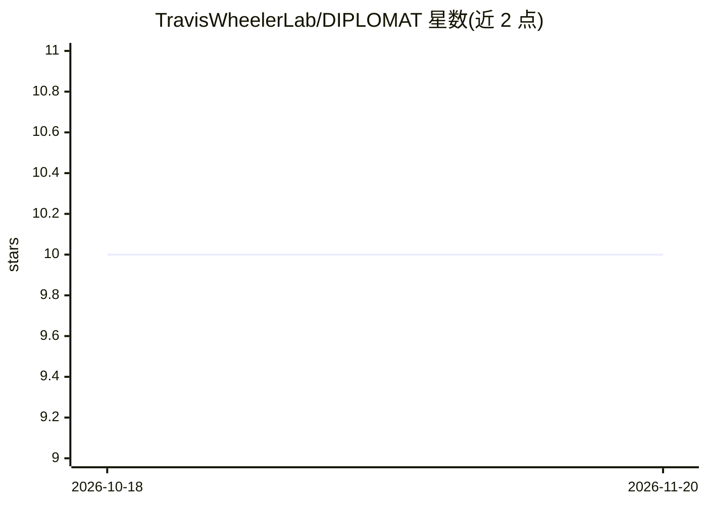

# TravisWheelerLab/DIPLOMAT

⭐ 10 · Python · BSD-3-Clause · 推送 2026-10-06 · [GitHub](https://github.com/TravisWheelerLab/DIPLOMAT) · 组织维护

**多动物行为视频的追踪与姿态校正工具**

DIPLOMAT 提供多动物追踪与姿态估计接口：输入视频和由 SLEAP 或 DeepLabCut 训练的姿态估计模型，计算多动物最大概率轨迹，并提供交互式编辑界面修正追踪错误后重新追踪。直接基于置信度图运行而不做峰值检测，输出带标注视频，支持 track/annotate/interact/tweak 等子命令。当前为早期 beta 软件，详细安装说明在文档站点。

## 筛选速览

| 维度 | 判定 | 备注 |
|---|---|---|
| AI 角色 | `ai-native` | 本体是模型或模型工具 |
| 许可风险 | `permissive` | BSD-3-Clause |
| 部署形态 | `None` |  |
| 模型依赖 | — | README 未给出锁定关系 |
| 硬件要求 | — | 无带数字的原话,不猜 |
| 安装摩擦 | `low` | 无编译、无系统依赖或容器化 |
| 成熟度 | `idea` | |

## 能力要点

- 基于 SLEAP/DeepLabCut 姿态模型计算多动物最大概率轨迹
- 直接读取置信度图进行追踪
- 提供交互式 UI 编辑与重追踪，支持 UI 状态文件保存与重开
- CLI 覆盖追踪、标注视频生成、微调与帮助查询

## 适用场景

- 追踪多只实验动物视频并减少个体身份混淆
- 交互修正自动追踪错误后重新追踪
- 为追踪结果生成带标注的视频

## 场景标签

`目标检测` · 领域:感知与多模态

## 证据(README 行号)

> L13: DIPLOMAT provides a multi-animal tracking/pose-estimation interface that (1) reduces identity swaps and body part l
> L16: DIPLOMAT computes a multi-animal maximum-probability trace to _**Track**_ multiple animals (and their body parts).

## 星数曲线

2026-10-18 10 → 2026-11-20 10（+0）

---
*卡片 v1 · prompt 1.4 · 生成 2026-11-20 · 置信度 high · 依据 README sha `1a1574876b0d` · [字段定义](../../DATASET.md)*
