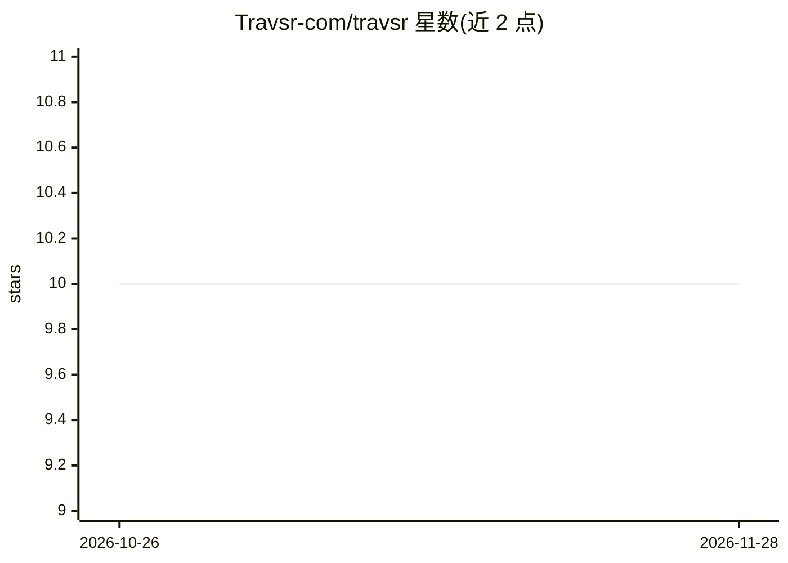

# Travsr-com/travsr

⭐ 10 · Rust · Apache-2.0 · 推送 2026-11-27 · [GitHub](https://github.com/Travsr-com/travsr) · [官网](https://travsr.com) · 组织维护

**面向 AI agent 的代码图 MCP 服务器：提供真实调用边上的代码智能**

以 git 仓库为单位的本地代码图工具：用 Tree-sitter 与 LSIF 构建调用、导入、引用边，索引存为仓库内的 SQLite 文件，通过 post-commit hook 与文件监视器增量更新。以 MCP 服务器形式向 AI agent 暴露查询工具（调用者、引用、影响面、执行路径、PPR 上下文等），支持多仓库全局注册表，`travsr connect` 可自动接线 Claude Code、Cursor 等多个 AI 编码工具。通过 shell 安装器或 npm 分发，Apache 2.0 许可。

## 筛选速览

| 维度 | 判定 | 备注 |
|---|---|---|
| AI 角色 | `ai-ecosystem` | LLM/agent 周边工具 |
| 许可风险 | `permissive` | Apache-2.0 |
| 部署形态 | `desktop` | 安装包/桌面程序 |
| 模型依赖 | — | README 未给出锁定关系 |
| 硬件要求 | — | 无带数字的原话,不猜 |
| 安装摩擦 | `medium` | 含编译或系统依赖之一 |
| 成熟度 | — | 结构信号不足 |

## 能力要点

- Tree-sitter/LSIF 构建真实调用/导入/引用边，索引用 SQLite 存于仓库内
- 单台 MCP 服务器服务全部已索引仓库，结果带 [repo-name] 前缀
- 17 个查询工具（get_callers/find_references/get_blast_radius/get_context 等）
- PreToolUse guard 可在 agent 发起文本搜索时给出图查询替换建议

## 适用场景

- 让 AI 编码助手基于调用图回答“谁调用了这个函数”
- 变更前评估某文件的传递影响面
- 在多仓库间做符号引用与依赖查询

## 场景标签

 · 领域:开发者工具/代码智能

## 证据(README 行号)

> L24: > that graph on every commit and exposes it via MCP so AI agents traverse real
> L126: Travsr speaks MCP, the open standard for
> L32: - **Works with the tools you already use.** One MCP server serves every repo you have indexed, and `travsr connect`

## 星数曲线

2026-10-26 10 → 2026-11-28 10（+0）

---
*卡片 v1 · prompt 1.4 · 生成 2026-11-20 · 置信度 high · 依据 README sha `bed758c8179a` · [字段定义](../../DATASET.md)*
