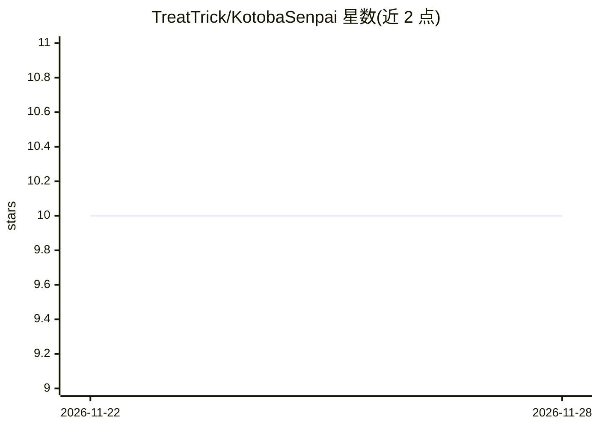

# TreatTrick/KotobaSenpai

⭐ 10 · C# · MIT · 推送 2026-11-22 · [GitHub](https://github.com/TreatTrick/KotobaSenpai) · [官网](https://treattrick.github.io/KotobaSenpai/) · 个人维护 · 中文 README

**日文 galgame 的 AI 阅读伴侣：注音、音调与译文覆盖显示**

面向 Windows 桌面的 .NET 10 WPF 应用，读取视觉小说游戏窗口文本，在游戏画面上方叠加显示汉字注音（furigana）、声调模式、结合上下文的词语/语法解释与整句翻译。目标解释与翻译语言不设固定列表，由所配置的 AI 模型支持的语言决定。内置词典在启动时自动准备；支持将配置提示词交给本地编码 Agent（Codex/Claude Code/Cursor）完成 provider 配置；通过 GitHub release 提供完整安装包与应用内更新。

## 筛选速览

| 维度 | 判定 | 备注 |
|---|---|---|
| AI 角色 | `ai-native` | 本体是模型或模型工具 |
| 许可风险 | `permissive` | MIT |
| 部署形态 | `None` |  |
| 模型依赖 | — | README 未给出锁定关系 |
| 硬件要求 | — | 无带数字的原话,不猜 |
| 安装摩擦 | `medium` | 含编译或系统依赖之一 |
| 成熟度 | — | 结构信号不足 |

## 能力要点

- 在视觉小说窗口上叠加 furigana 与声调标注
- 结合句子上下文给出词语/语法解释与整句翻译
- 目标解释语言不限固定列表，取决于所用 AI 模型
- 可将 API 配置交给本地编码 Agent 自动完成

## 适用场景

- 边玩日文视觉小说边获取注音与翻译
- 按自己选择的界面外语言阅读日文文本
- 用本地 Agent 代为完成 AI provider 配置

## 场景标签

 · 领域:语言学习/桌面工具

## 证据(README 行号)

> L7: An AI reading companion for Japanese visual novels. Furigana, pitch accents, contextual explanations, and sentence t
> L53: KotobaSenpai uses the surrounding sentence to explain words and meaningful grammar patterns, including expressions 
> L75: KotobaSenpai is a Windows desktop app built with **.NET 10** and **WPF**. Its focused interface and in-window overl

## 星数曲线

2026-11-22 10 → 2026-11-28 10（+0）

---
*卡片 v1 · prompt 1.4 · 生成 2026-11-22 · 置信度 high · 依据 README sha `49609d4c9f38` · [字段定义](../../DATASET.md)*
