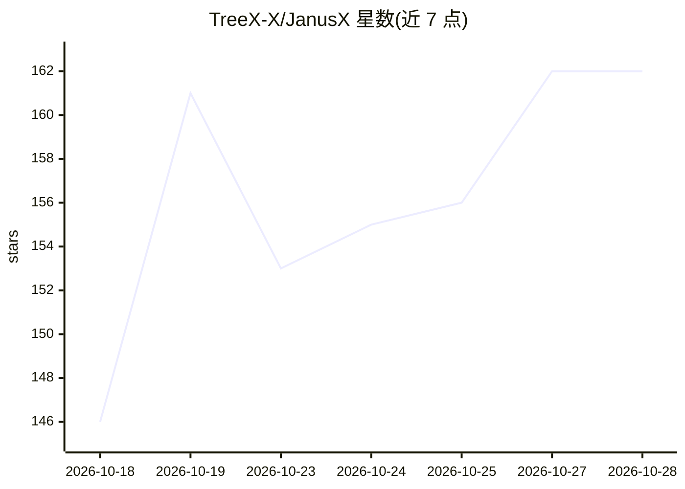

# TreeX-X/JanusX

⭐ 162 · TypeScript · MIT · 推送 2026-10-23 · [GitHub](https://github.com/TreeX-X/JanusX) · [官网](https://treex-x.github.io/JanusX/) · 个人维护 · 中文 README

**把项目、终端与 AI 编程 CLI 放进同一桌面工作区的 Electron 应用**

开源 Electron 桌面应用（Windows x64 安装版/便携版）：以多终端分屏为核心，托管 Claude Code、Codex、OpenCode、Pi 等 AI CLI 并行运行，提供 Island 对话（附项目上下文、读取代码）、对话生成运行配置、蓝图文档维护与 Git 提交自动审核、终端与历史用量统计、外部 CLI 会话发现与续接、Git worktree 多工作线、内置浏览器/Markdown/文件树等工具区。AI 能力依赖用户自行安装配置对应 CLI 与模型；macOS/Linux 公开安装包以 Releases 为准；创新功能仍在开发中，10 月二测非正式版。

## 筛选速览

| 维度 | 判定 | 备注 |
|---|---|---|
| AI 角色 | `ai-enhanced` | 去掉 AI 部分产品仍成立 |
| 许可风险 | `permissive` | MIT |
| 部署形态 | `desktop` | 安装包/桌面程序 |
| 模型依赖 | — | README 未给出锁定关系 |
| 硬件要求 | — | 无带数字的原话,不猜 |
| 安装摩擦 | `low` | 无编译、无系统依赖或容器化 |
| 成熟度 | `idea` | |

## 能力要点

- 多终端分屏并行运行 Claude Code/Codex/OpenCode/Pi 等 AI CLI
- Island 对话附项目上下文、读取代码并支持连续追问
- 蓝图读取 .agents/notes/ 文档并按 Git 提交触发审核
- 终端明细与历史用量统计（按时间/引擎查看趋势、热力与估算费用）

## 适用场景

- 在同一桌面并行使用多个 AI 编程 CLI 对照开发
- 用对话生成并测试项目的运行配置
- 借助 worktree 在独立分支推进任务同时主线服务不断
- 回看历史会话并从入口继续原对话

## 场景标签

 · 领域:开发者工具/AI 编程桌面

## 证据(README 行号)

> L9: ### 把项目、终端与 AI 编程助手放进同一个桌面工作区
> L138: 终端可使用 Shell、Janus-agentX、Claude Code、Codex、OpenCode、Pi 等工具；相应 CLI 的安装、登录与模型配置需另行完成。蓝图、Island 与运行配置中的模型能力也需要可用的模型配置
> L217: JanusX 是一个真实投入社区使用的开源实验项目，目标是让 AI 辅助开发有一个顺手的桌面落点：项目、终端、AI CLI 与常用工具同处一室，稳定的基础体验在前，激进的协作实验在后。

## 星数曲线

2026-10-18 146 → 2026-10-28 162（+16）

---
*卡片 v1 · prompt 1.4 · 生成 2026-10-23 · 置信度 high · 依据 README sha `d028d71555cc` · [字段定义](../../DATASET.md)*
