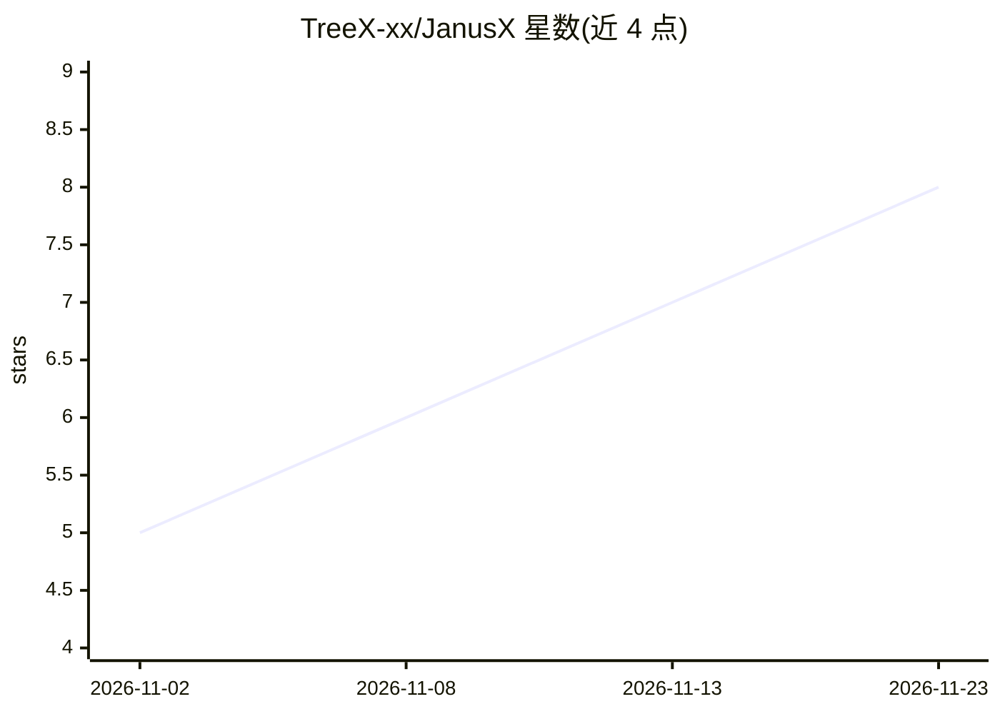

# TreeX-xx/JanusX

⭐ 8 · TypeScript · MIT · 推送 2026-11-22 · [GitHub](https://github.com/TreeX-xx/JanusX) · [官网](https://treex-xx.github.io/JanusX/) · 个人维护 · 中文 README

**AI 编程桌面工作区：集中管理项目、终端与 AI 助手会话**

基于 Electron 的桌面应用，将本地项目、多个终端分屏与 AI CLI 助手会话整合在同一界面：可在 Shell、Claude Code、Codex、OpenCode 等 CLI 间切换并在同一会话中切换终端/聊天视图，支持 Git Worktree 并行开发、文件浏览、Git 历史、会话历史检索、运行配置与用量统计，通过插件扩展 Docker 管理、CLIProxyAPI 托管与后台 Worker 委派。提供 Windows x64 安装包/便携版与 Apple Silicon dmg，无需 Node.js。

## 筛选速览

| 维度 | 判定 | 备注 |
|---|---|---|
| AI 角色 | `ai-ecosystem` | LLM/agent 周边工具 |
| 许可风险 | `permissive` | MIT |
| 部署形态 | `desktop` | 安装包/桌面程序 |
| 模型依赖 | — | README 未给出锁定关系 |
| 硬件要求 | — | 无带数字的原话,不猜 |
| 安装摩擦 | `low` | 无编译、无系统依赖或容器化 |
| 成熟度 | — | 结构信号不足 |

## 能力要点

- 多终端分屏，支持 Shell/Claude Code/Codex/OpenCode 等 CLI
- 同一会话内终端与聊天视图切换，可跟进文件引用与审批
- Git Worktree 并行开发与合并流程
- 插件机制：Blueprint、CPA、Docker、SuperAgent

## 适用场景

- 在多项目间集中管理终端分屏与 AI 助手会话
- 用 Worktree 在主分支预览服务运行时并行开发
- 检索并恢复历史 AI 会话记录

## 场景标签

`AI 助手` · 领域:对话与助手

## 证据(README 行号)

> L7: ### A desktop workspace for projects, terminals, and AI coding agents
> L49: Run Shell, Claude Code, Codex, OpenCode, Pi, and other CLIs in one workspace. Drag tabs into horizontal or vertical
> L55: Switch between terminal and chat in a supported AI CLI session. Use the terminal for direct interaction, or open ch

## 星数曲线

2026-11-02 5 → 2026-11-23 8（+3）

---
*卡片 v1 · prompt 1.4 · 生成 2026-11-20 · 置信度 high · 依据 README sha `3778874cf4ad` · [字段定义](../../DATASET.md)*
