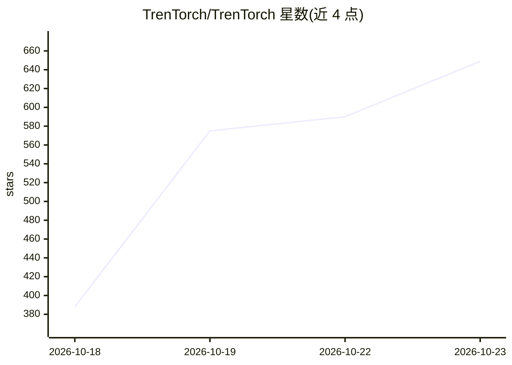

# TrenTorch/TrenTorch

⭐ 649 · Python · NOASSERTION · 推送 2026-10-22 · [GitHub](https://github.com/TrenTorch/TrenTorch) · [官网](https://trentorch.com) · 组织维护

**从零构建 ML 框架的教学课程：浏览器刷题 + CLI 模块实践**

面向机器学习学习者的教育项目，提供两种形态：Web 版（SvelteKit，350+ 编程题、12 专题，Python 经 Pyodide 在浏览器内运行与判题，账号保存进度）与 CLI 版（基于哈佛 TinyTorch 课程重建扩展的 20 个模块，从张量、autograd 到量化、加速与 capstone，用 NumPy 逐步搭建自有框架，不 import PyTorch）。CLI 需 Python 3.10+，全程 CPU 运行，无需 GPU。采用 PolyForm 非商业许可，商业使用需联系作者。

## 筛选速览

| 维度 | 判定 | 备注 |
|---|---|---|
| AI 角色 | `ai-knowledge` | 知识聚合/清单类 |
| 许可风险 | `none` | NOASSERTION |
| 部署形态 | `library` | 以包/库形式分发 |
| 模型依赖 | — | README 未给出锁定关系 |
| 硬件要求 | — | 无带数字的原话,不猜 |
| 安装摩擦 | `low` | 无编译、无系统依赖或容器化 |
| 成熟度 | — | 结构信号不足 |

## 能力要点

- CLI 版 20 个模块从张量到 capstone 自建框架，全程仅用 NumPy
- Web 版 350+ 编程题覆盖 12 专题，Pyodide 浏览器内运行判题
- 含 1958-2018 的历史里程碑复现（感知机、反向传播、Transformer 等）
- 不依赖 GPU、PyTorch 或 TensorFlow

## 适用场景

- 通过亲手实现 autograd、量化等组件理解 ML 框架原理
- 在浏览器零安装刷 ML 编程题准备面试
- 按模块进度完成从零搭建框架的系统化学习

## 场景标签

`教程课程` · 领域:学习与行业

## 证据(README 行号)

> L5: **Learn ML by building it: a from-scratch machine learning framework in NumPy, and hundreds of coding questions that
> L21: > The CLI curriculum is our implementation of TinyTorch (Harvard CS249r), rebuilt and extended in our own style. Th
> L78: |**What**|350+ coding questions in 12 topic areas|20 modules that build a framework, from tensors to a capstone|

## 星数曲线

2026-10-18 388 → 2026-10-23 649（+261）

---
*卡片 v1 · prompt 1.4 · 生成 2026-10-21 · 置信度 high · 依据 README sha `c033c5b10291` · [字段定义](../../DATASET.md)*
