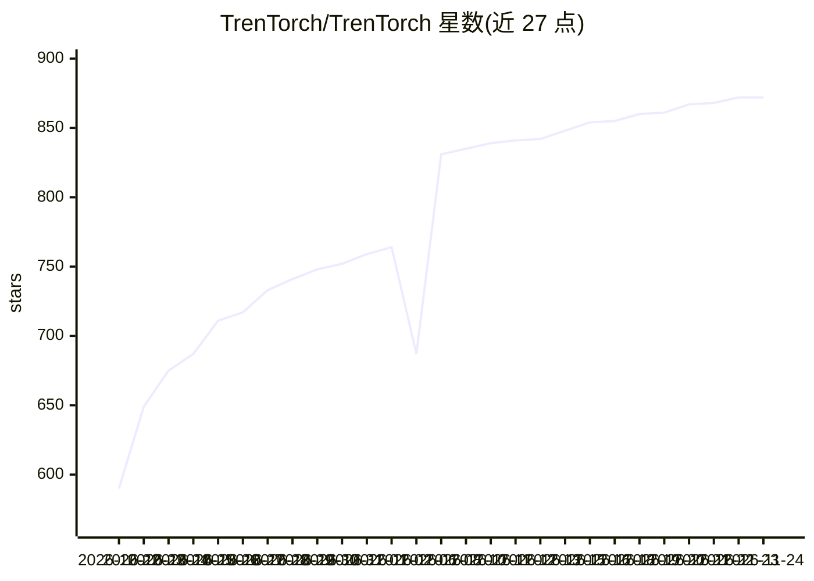

# TrenTorch/TrenTorch

⭐ 872 · Python · NOASSERTION · 推送 2026-11-22 · [GitHub](https://github.com/TrenTorch/TrenTorch) · [官网](https://trentorch.com) · 组织维护

**从零用 NumPy 构建 ML 框架的学习平台与题库**

以'自己动手实现'为核心的教学项目：提供浏览器版（1647 道题、12 个主题区，Python 经 Pyodide 在浏览器内运行并即时评分）与 CLI 版（20 个模块从张量、autograd 到 transformers 与量化压缩，逐步构建出用户自己的框架），并附可复现的里程碑实验（Perceptron、CNN、Transformer 等）。CLI 版是 TinyTorch（Harvard CS249r）的实现与扩展，全部基于 NumPy，不使用 PyTorch/TensorFlow。许可为 PolyForm Noncommercial，商用需联系作者。

## 筛选速览

| 维度 | 判定 | 备注 |
|---|---|---|
| AI 角色 | `ai-knowledge` | 知识聚合/清单类 |
| 许可风险 | `none` | NOASSERTION |
| 部署形态 | `library` | 以包/库形式分发 |
| 模型依赖 | — | README 未给出锁定关系 |
| 硬件要求 | — | 无带数字的原话,不猜 |
| 安装摩擦 | `medium` | 含编译或系统依赖之一 |
| 成熟度 | — | 结构信号不足 |

## 能力要点

- 浏览器内答题：Pyodide 运行 Python，无需安装、即时评分
- CLI 20 模块从零构建框架：张量、autograd、优化器到 transformers 与量化
- 里程碑实验：在自建框架上复现 Perceptron、CNN、Transformer 等
- 问题带题面、理论讲解、起始文件、测试与参考解答

## 适用场景

- 想理解 ML 框架底层原理而非只会调库
- 准备机器学习面试刷题
- 课程/自学路径：跟随 CLI 模块逐个实现框架组件

## 场景标签

`教程课程` `模型量化` · 领域:学习与行业

## 证据(README 行号)

> L3: **Learn ML by building it: a from-scratch machine learning framework in NumPy, and hundreds of coding questions that
> L90: |**What**|1647 coding problems in 12 topic areas|20 modules that build a framework, from tensors to a capstone|
> L396: No. Everything runs on the CPU with NumPy, and the curriculum never imports PyTorch or TensorFlow. The CLI needs P

## 星数曲线

2026-10-22 590 → 2026-11-24 872（+282）

---
*卡片 v1 · prompt 1.4 · 生成 2026-11-24 · 置信度 high · 依据 README sha `bc967d34a6e4` · [字段定义](../../DATASET.md)*
