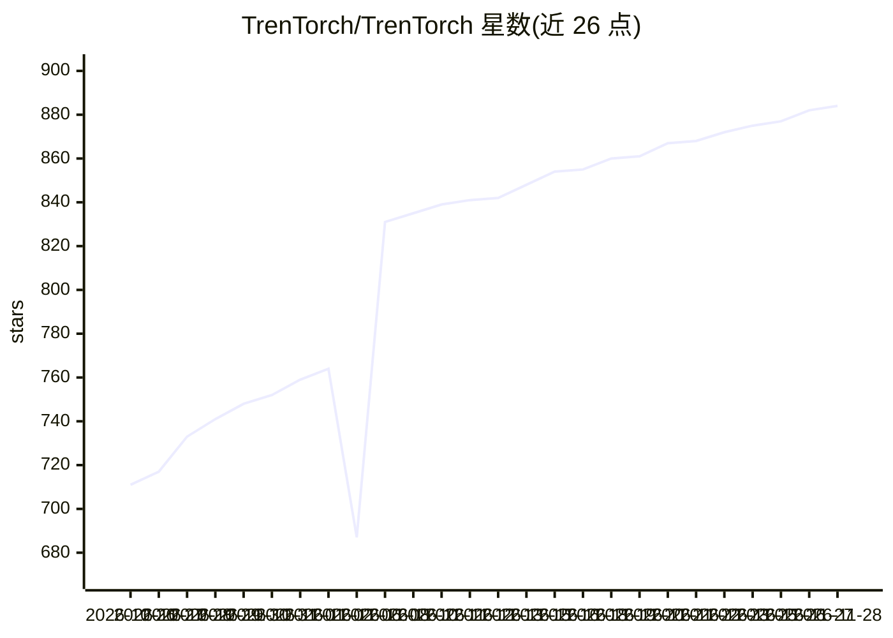

# TrenTorch/TrenTorch

⭐ 884 · Python · NOASSERTION · 推送 2026-11-25 · [GitHub](https://github.com/TrenTorch/TrenTorch) · [官网](https://trentorch.com) · 组织维护

**从零实现 ML 框架的学习平台：1647 道浏览器内判题题与 20 模块课程**

面向想理解机器学习内部原理的学习者：提供两条路径——浏览器版含 1647 道编码题、12 个主题区，代码经 Pyodide 在浏览器内运行并即时判题，进度存账号；CLI 版含 20 个模块，用 NumPy 从张量、autograd、优化器逐层搭建一个完整框架直至 capstone，进度存本地。课程不 import PyTorch/TensorFlow，全部在 CPU 上运行，无需 GPU。随进度解锁感知机、反向传播、Transformer 等 6 个历史里程碑复现。CLI 课程为哈佛 TinyTorch（CS249r）的自研实现，Web 版独立开发。

## 筛选速览

| 维度 | 判定 | 备注 |
|---|---|---|
| AI 角色 | `ai-knowledge` | 知识聚合/清单类 |
| 许可风险 | `none` | NOASSERTION |
| 部署形态 | `library` | 以包/库形式分发 |
| 模型依赖 | — | README 未给出锁定关系 |
| 硬件要求 | — | 无带数字的原话,不猜 |
| 安装摩擦 | `medium` | 含编译或系统依赖之一 |
| 成熟度 | — | 结构信号不足 |

## 能力要点

- 浏览器内 Pyodide 运行与即时判题，无需安装
- CLI 版用 NumPy 从零实现张量、autograd 到 Transformer 的 20 个模块
- 解锁 1958-2018+ 六个里程碑结果复现（Perceptron 至 MLPerf）
- 课程全程不使用 PyTorch/TensorFlow，CPU 即可运行

## 适用场景

- 我想通过亲手实现 autograd 和注意力机制来理解 ML 原理
- 准备 ML 面试，按 12 个主题区刷编码题
- 在没有 GPU 的机器上学习深度学习课程
- 想在课程或个人项目里复现经典 ML 里程碑

## 场景标签

`教程课程` · 领域:学习与行业

## 证据(README 行号)

> L3: **Learn ML by building it: a from-scratch machine learning framework in NumPy, and hundreds of coding questions that
> L90: |**What**|1647 coding problems in 12 topic areas|20 modules that build a framework, from tensors to a capstone|
> L396: No. Everything runs on the CPU with NumPy, and the curriculum never imports PyTorch or TensorFlow. The CLI needs P

## 星数曲线

2026-10-26 711 → 2026-11-28 884（+173）

---
*卡片 v1 · prompt 1.4 · 生成 2026-11-26 · 置信度 high · 依据 README sha `fa0859e93cc5` · [字段定义](../../DATASET.md)*
