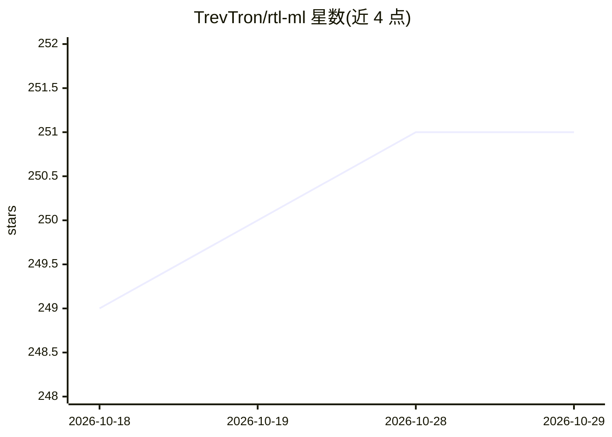

# TrevTron/rtl-ml

⭐ 251 · Python · MIT · 推送 2026-06-02 · [GitHub](https://github.com/TrevTron/rtl-ml) · 个人维护

**RTL-SDR 无线电信号机器学习分类器，运行于 ARM 单板机**

在约 $220 的 ARM 单板机（Indiedroid Nova / Raspberry Pi 4/5）加 RTL-SDR Blog V4 硬件上运行的无线电信号分类工具：采集 0.5 秒 IQ 样本，提取 17 个数值特征（功率、FFT、I/Q、相位、带宽），用 Random Forest（100 棵树）识别 FM 广播、NOAA 天气、APRS、FRS/GMRS、ISM 传感器、寻呼机与噪声 7 类信号，800 样本时序切分下测试准确率 96.9%。提供完整采集→训练→分类流水线，含预训练模型与 Hugging Face 数据集；不依赖云端与 GPU，模型约 200KB。限制：RTL-SDR V4 需安装专用驱动分支，FRS/GMRS 与寻呼机存在少量类别混淆。

## 筛选速览

| 维度 | 判定 | 备注 |
|---|---|---|
| AI 角色 | `ai-native` | 本体是模型或模型工具 |
| 许可风险 | `permissive` | MIT |
| 部署形态 | `library` | 以包/库形式分发 |
| 模型依赖 | — | README 未给出锁定关系 |
| 硬件要求 | `cpu-ok` | |
| 安装摩擦 | `low` | 无编译、无系统依赖或容器化 |
| 成熟度 | — | 结构信号不足 |

## 能力要点

- 17 个特征 + Random Forest 分类 7 类无线电信号，测试准确率 96.9%
- 无需 GPU 与云端，在 ARM 边缘设备上推理（Pi 5 约 14ms）
- 800 个实测样本带 DC 去除、SNR 门控与时序切分（无数据泄漏）
- 提供预训练模型与 Hugging Face 预采集数据集

## 适用场景

- 在树莓派等单板机上自动识别空中无线电信号类型
- 频谱监测与扫描时跳过空频段、记录感兴趣的信号
- 学习 ML 与射频结合的端到端实践（采集→训练→分类）
- 识别 433 MHz IoT 设备与天气/应急广播信号

## 场景标签

 · 领域:无线电/信号分类（边缘 ML）

## 证据(README 行号)

> L13: - ✅ **96.9% accuracy** classifying 7 real-world radio signal types
> L196: **Random Forest classifier** (100 decision trees) trained on 800 real-world samples with temporal train/test split
> L178: RTL-SDR V4 → USB → ARM SBC → Python (pyrtlsdr)

## 星数曲线

2026-10-18 249 → 2026-10-29 251（+2）

---
*卡片 v1 · prompt 1.4 · 生成 2026-10-22 · 置信度 mid · 依据 README sha `290f6358e8d0` · [字段定义](../../DATASET.md)*
