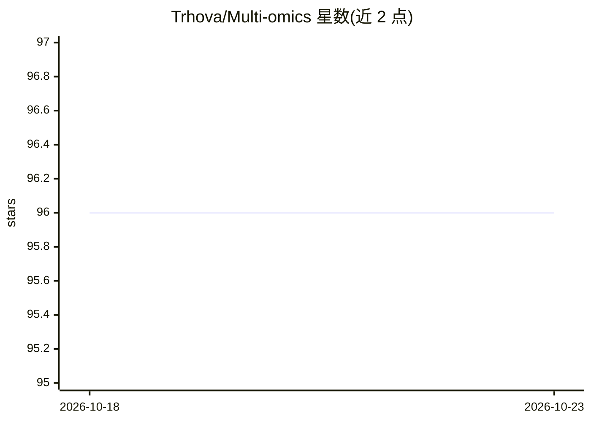

# Trhova/Multi-omics

⭐ 96 · Python · 推送 2025-12-28 · [GitHub](https://github.com/Trhova/Multi-omics) · 个人维护

**多组学整合方法（DIABLO/DIVAS/VAE）的入门教程与示例代码**

面向从事微生物组、代谢组学、转录组学等多组学研究的用户的直觉性教学仓库：用一个贯穿全篇的小型玩具数据集（4 名患者、3 个组学块、1 个分组标签）讲解 DIABLO（监督式潜在成分与特征选择）、DIVAS（全共享/部分共享/独有结构分解）、多模态 VAE（含标签条件化），并覆盖 MOFA、JIVE、SNF、CCA/PLS/PCA 等方法族。内容强调整合能做与不能做的事（如不能证明因果与方向），讲解泄漏、批次效应等常见陷阱；提供可直接运行的 Python 与 R 示例脚本。

## 筛选速览

| 维度 | 判定 | 备注 |
|---|---|---|
| AI 角色 | `ai-knowledge` | 知识聚合/清单类 |
| 许可风险 | `none` | — |
| 部署形态 | `None` |  |
| 模型依赖 | — | README 未给出锁定关系 |
| 硬件要求 | — | 无带数字的原话,不猜 |
| 安装摩擦 | `low` | 无编译、无系统依赖或容器化 |
| 成熟度 | — | 结构信号不足 |

## 能力要点

- DIABLO 监督式多组学整合机制讲解与 mixOmics R 示例
- DIVAS 按全共享/部分共享/独有分解变异结构
- 多模态 VAE 与条件 VAE（标签条件化）讲解及 PyTorch 骨架代码
- 统一玩具数据集贯穿所有方法，附泄漏与批次效应等实践提示

## 适用场景

- 我想入门多组学整合方法并理解各方法适用边界
- 我要为有标签的多组学数据选跨组学签名方法（DIABLO）
- 我想在无标签场景下探索各层间共享与独有结构（DIVAS/MOFA）

## 场景标签

`教程课程` · 领域:学习与行业

## 证据(README 行号)

> L1: # Practical Multi-Omics Integration (DIABLO, DIVAS, VAEs + a few essentials)
> L3: A condensed-but-thorough, intuitive guide for people doing multi-omics (microbiome, metabolomics, transcriptomics, p

## 星数曲线

2026-10-18 96 → 2026-10-23 96（+0）

---
*卡片 v1 · prompt 1.4 · 生成 2026-10-23 · 置信度 high · 依据 README sha `1a292540775e` · [字段定义](../../DATASET.md)*
