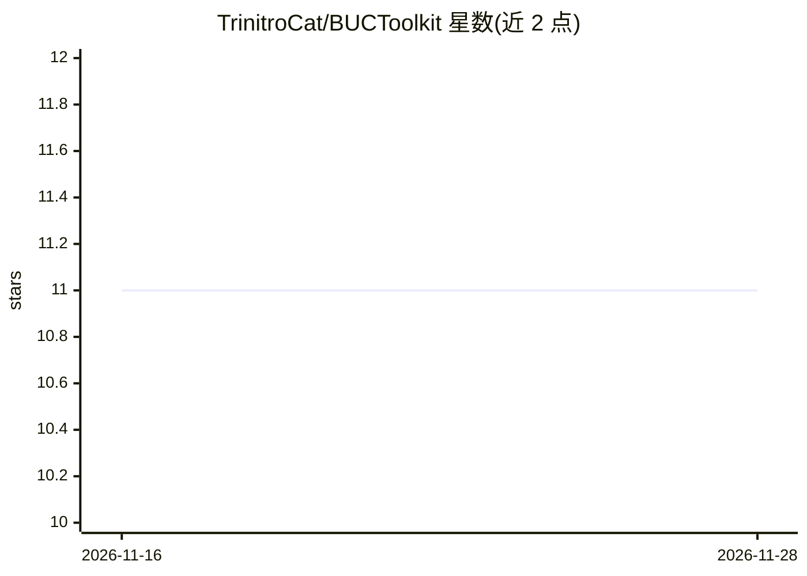

# TrinitroCat/BUCToolkit

⭐ 11 · Python · MIT · 推送 2026-11-11 · [GitHub](https://github.com/TrinitroCat/BUCToolkit) · 个人维护 · 中文 README

**面向计算化学/催化的 PyTorch 批量模拟软件包**

基于 PyTorch 的 AI4Science 计算化学软件包，调用任意返回能量与能量梯度的 Python 函数（典型输入为深度学习势模型），执行结构优化（极小化与过渡态搜索）、分子动力学（含约束）、蒙特卡洛模拟，并为 PyTorch 模型提供训练与预测 API。核心函数支持常规与不规则批并行，通过算子融合、CUDA graph 重放、异步输出管线等优化。另含催化结构文件预处理/后处理工具、YAML 输入文件驱动的可执行程序与交互式 CLI。可作为 Python 包或命令行程序使用，通过 pip 或源码安装。

## 筛选速览

| 维度 | 判定 | 备注 |
|---|---|---|
| AI 角色 | `ai-native` | 本体是模型或模型工具 |
| 许可风险 | `permissive` | MIT |
| 部署形态 | `library` | 以包/库形式分发 |
| 模型依赖 | — | README 未给出锁定关系 |
| 硬件要求 | — | 无带数字的原话,不猜 |
| 安装摩擦 | `medium` | 含编译或系统依赖之一 |
| 成熟度 | — | 结构信号不足 |

## 能力要点

- 结构优化、过渡态搜索、分子动力学、蒙特卡洛模拟四类任务
- 常规与不规则结构批并行，支持算子融合与 CUDA graph 重放
- 读取 POSCAR/OUTCAR/ExtXyz/cif 并输出文本日志与二进制数据库文件
- 可执行程序模式支持 pyg/mace/vasp/custom 多种模型接入方式

## 适用场景

- 训练自己的 torch-geometric 势模型并跑结构优化
- 对催化体系批量执行分子动力学或蒙特卡洛采样
- 在 VASP 等外部程序与模型之间转换结构文件格式

## 场景标签

`科研工具` · 领域:学习与行业

## 证据(README 行号)

> L8: BUCToolkit is a PyTorch-based high-performance AI4Science software package of computational chemistry,
> L13: The most typical input functions are PyTorch-based **deep-learning models** (of molecular or crystal potentials).

## 星数曲线

2026-11-16 11 → 2026-11-28 11（+0）

---
*卡片 v1 · prompt 1.4 · 生成 2026-11-18 · 置信度 high · 依据 README sha `ecc9cbfeda54` · [字段定义](../../DATASET.md)*
