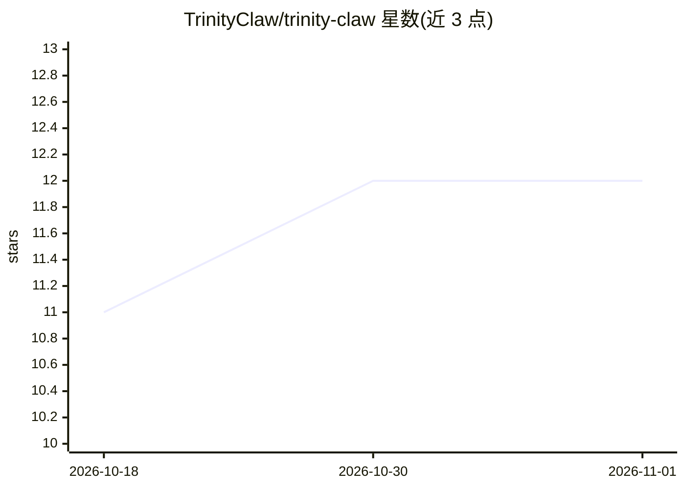

# TrinityClaw/trinity-claw

⭐ 12 · Python · MIT · 推送 2026-10-21 · [GitHub](https://github.com/TrinityClaw/trinity-claw) · [官网](https://trinityclaw.com) · 个人维护

**本地自托管的自改进 AI agent：思考、执行任务、记忆持久化**

运行在用户本机（明确禁止公网部署）的自我修改型 AI agent：具备动态技能创建、ChromaDB 持久记忆与会话快照、每 15 分钟后台心跳复盘等机制。能力覆盖网页浏览、Playwright 浏览器自动化、CDP 挂载已登录 Chrome、MCP 客户端、Composio 接入 200+ 应用、Telegram 交互（含 Whisper 本地语音转录与视觉模型识图）、Gmail/日历、调度任务等。技能在隔离 Docker 容器内运行，经 AST 校验与模块黑名单防护；模型可选云端 API 或本地 Ollama。Windows/macOS/Linux 均提供一键安装脚本，Docker 为唯一前置依赖。

## 筛选速览

| 维度 | 判定 | 备注 |
|---|---|---|
| AI 角色 | `ai-native` | 本体是模型或模型工具 |
| 许可风险 | `permissive` | MIT |
| 部署形态 | `desktop` | 安装包/桌面程序 |
| 模型依赖 | local-ok | 支持本地模型 |
| 硬件要求 | — | 无带数字的原话,不猜 |
| 安装摩擦 | `low` | 无编译、无系统依赖或容器化 |
| 成熟度 | — | 结构信号不足 |

## 能力要点

- 动态技能创建 + AST 校验、模块黑名单与 Docker 隔离
- 持久记忆：ChromaDB 向量存储、每日日志、开放承诺追踪、每周元回顾
- 通过 CDP 挂载已登录 Chrome 直接操作 Twitter/X、LinkedIn 等平台
- MCP 客户端与 Composio 集成（200+ 应用，OAuth 自动处理）

## 适用场景

- 在本机跑一个能浏览网页、执行代码、管理文件的私人 AI 助手
- 通过 Telegram 用文字、语音、照片与 agent 对话并交代任务
- 把个人文档放入文件夹构建自己的业务知识库
- 定时执行监控、邮件处理等自动化任务

## 场景标签

`AI 助手` `浏览器自动化` `Agent 记忆` · 领域:Agent 开发

## 证据(README 行号)

> L10: A self-modifying AI agent with persistent memory, dynamic skill creation, and intelligent reasoning capabilities.
> L43: - **Self-Modifying**: Creates new skills dynamically

## 星数曲线

2026-10-18 11 → 2026-11-01 12（+1）

---
*卡片 v1 · prompt 1.4 · 生成 2026-11-01 · 置信度 high · 依据 README sha `6f3e84884297` · [字段定义](../../DATASET.md)*
