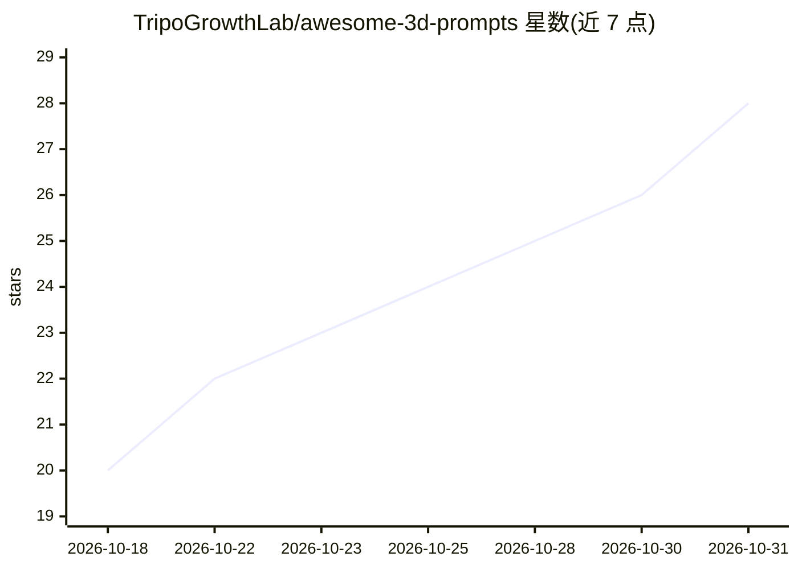

# TripoGrowthLab/awesome-3d-prompts

⭐ 28 · JavaScript · NOASSERTION · 推送 2026-10-02 · [GitHub](https://github.com/TripoGrowthLab/awesome-3d-prompts) · [官网](https://www.tripo3d.ai/3d-prompts) · 组织维护 · 中文 README

**3D 创作 AI 提示词策展清单：496 例、6 模型、14 语言**

面向 3D 创作者与 prompt 使用者的示例策展仓库：收录 496 个 3D prompts，覆盖游戏（129）、场景（108）、资产（59）、交互（101）、动画（95）等类别，标注生成模型（GPT-6 Astra、Claude Opus/Fable、Kimi K3）。条目保留创作者署名与原始出处链接，部分附参考图与源码（17 例），提示词提供中英等 14 种语言版本，由 CMS 生成维护，使用方式为查看效果、复制并改编 prompt 后在编码助手或 3D 工作流中运行。

## 筛选速览

| 维度 | 判定 | 备注 |
|---|---|---|
| AI 角色 | `ai-knowledge` | 知识聚合/清单类 |
| 许可风险 | `none` | NOASSERTION |
| 部署形态 | `None` |  |
| 模型依赖 | — | README 未给出锁定关系 |
| 硬件要求 | — | 无带数字的原话,不猜 |
| 安装摩擦 | `low` | 无编译、无系统依赖或容器化 |
| 成熟度 | — | 结构信号不足 |

## 能力要点

- 496 个示例按类别与模型双维度组织
- 6 个模型来源：GPT-6 Astra、Claude Opus/Fable 系列、Kimi K3
- 条目保留创作者署名与原帖链接，17 例附源码
- 提示词提供 14 种语言版本，含中英对照原文

## 适用场景

- 为 3D 游戏、场景或动画项目寻找可改编的 prompt 范例
- 按模型浏览对比不同 AI 生成的 3D 作品效果
- 学习结构完整的 3D 交互项目提示词写法

## 场景标签

`精选清单` `提示工程` · 领域:Agent 开发

## 证据(README 行号)

> L26: 3D prompts across Astra, Claude and Kimi: games, scenes, assets, animation and interactive experiences. See the res
> L28: **496 examples · 6 models · 14 languages · 17 with source code**
> L40: |Browse by category|Examples|

## 星数曲线

2026-10-18 20 → 2026-10-31 28（+8）

---
*卡片 v1 · prompt 1.4 · 生成 2026-10-27 · 置信度 high · 依据 README sha `784cfbf8e830` · [字段定义](../../DATASET.md)*
