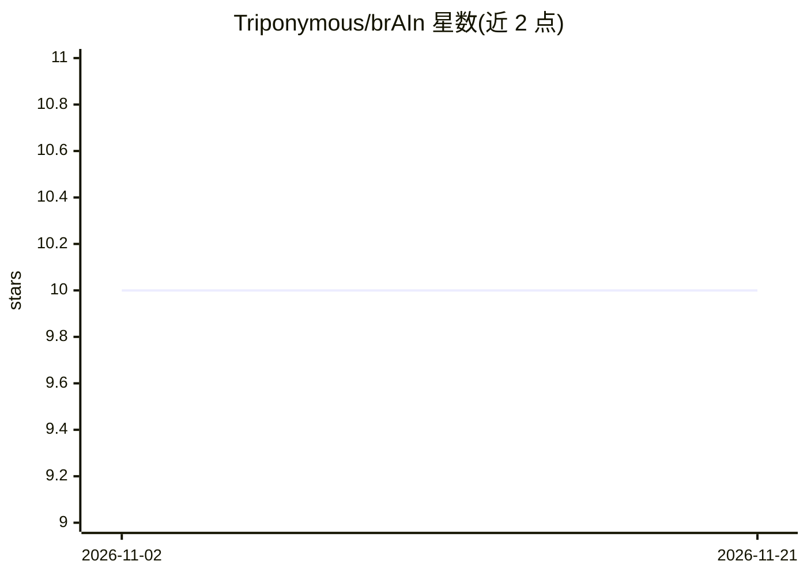

# Triponymous/brAIn

⭐ 10 · Python · MIT · 推送 2026-09-27 · [GitHub](https://github.com/Triponymous/brAIn) · 个人维护

**用脉冲神经网络学习个人上下文的本地优先桌面研究原型**

本地优先的研究项目：一个基于 PyTorch/snnTorch 的 LIF 脉冲神经网络（含 STDP/BCM、竞争概念与工作记忆），在线学习桌面元数据中用户标注的模式；配套 Observatory 交互式 3D 仪表盘（英/德双语导览）、可持久运行的 research daemon，以及经 stdio 暴露九个查询工具的 brain-mcp 接口供 AI 助手按需读取。README 明确为研究原型，真实性用、跨平台传感器支持与基线优势均未经控制评估验证；真实桌面传感器目前针对 macOS。

## 筛选速览

| 维度 | 判定 | 备注 |
|---|---|---|
| AI 角色 | `ai-native` | 本体是模型或模型工具 |
| 许可风险 | `permissive` | MIT |
| 部署形态 | `library` | 以包/库形式分发 |
| 模型依赖 | — | README 未给出锁定关系 |
| 硬件要求 | — | 无带数字的原话,不猜 |
| 安装摩擦 | `medium` | 含编译或系统依赖之一 |
| 成熟度 | `idea` | |

## 能力要点

- PyTorch LIF + STDP/BCM 的在线学习 SNN 核心
- Observatory 交互式 3D 图谱与 18 步英/德导览
- brain-mcp 提供九个只读查询工具（stdio）
- 四/五个桌面元数据源默认关闭、可逐个开关

## 适用场景

- 研究个人上下文在线学习与脉冲网络行为
- 通过 MCP 让本地 AI 助手查询学习到的习惯与异常
- 在 Observatory 中检查模型步骤与捕获状态

## 场景标签

 · 领域:桌面工具/神经形态研究

## 证据(README 行号)

> L3: A local-first research project exploring **personal context learned over time**:
> L19: |SNN core|PyTorch LIF steps, fixed expansion, STDP/BCM, competitive concepts, working memory and model modulators|O
> L97: The `brain-mcp` executable exposes nine query tools from that daemon:

## 星数曲线

2026-11-02 10 → 2026-11-21 10（+0）

---
*卡片 v1 · prompt 1.4 · 生成 2026-11-20 · 置信度 mid · 依据 README sha `f41691df3a52` · [字段定义](../../DATASET.md)*
