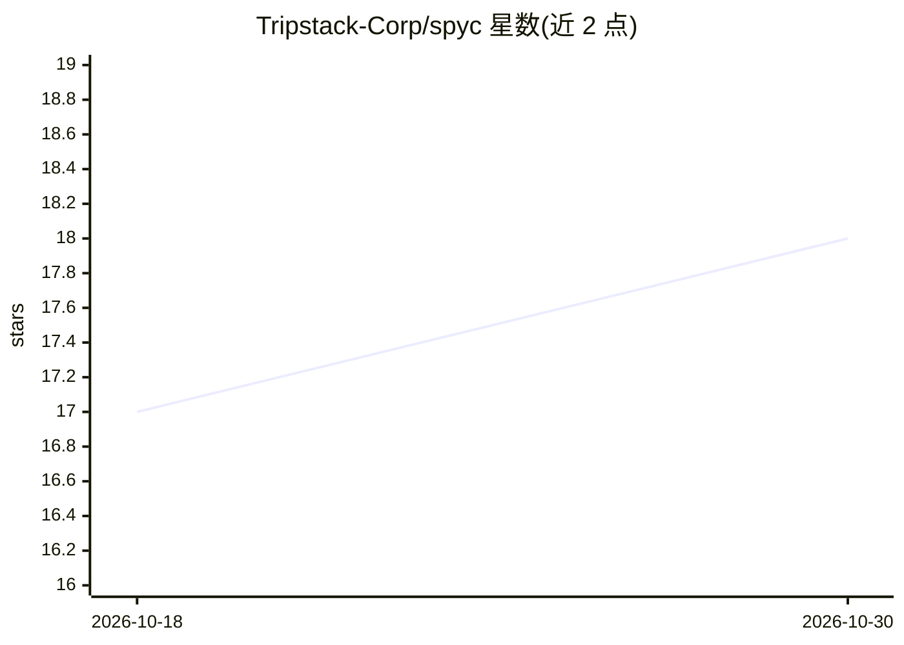

# Tripstack-Corp/spyc

⭐ 18 · Rust · BSD-3-Clause · 推送 2026-10-29 · [GitHub](https://github.com/Tripstack-Corp/spyc) · 组织维护

**面向编码 agent 的终端文件指挥器：通过本地 MCP 共享工作集**

Rust 编写的双窗格终端程序：上方是 vim 风格、git 感知的键盘驱动文件指挥器；下方是作为子进程运行的编码 agent（默认 Claude Code，Codex、Antigravity、zot 亦可）。spyc 启动时运行本地 MCP 服务器，agent 可查询光标位置、pick 选择、过滤状态、git 分支与 worktree 等结构化状态，无需复制粘贴路径。内置真实终端模拟器（libghostty-vt）、Lua 脚本、多项目多标签、会话自动保存与恢复。macOS 与 Linux 提供预构建二进制。

## 筛选速览

| 维度 | 判定 | 备注 |
|---|---|---|
| AI 角色 | `ai-enhanced` | 去掉 AI 部分产品仍成立 |
| 许可风险 | `permissive` | BSD-3-Clause |
| 部署形态 | `library` | 以包/库形式分发 |
| 模型依赖 | locked-api |  |
| 硬件要求 | — | 无带数字的原话,不猜 |
| 安装摩擦 | `low` | 无编译、无系统依赖或容器化 |
| 成熟度 | — | 结构信号不足 |

## 能力要点

- 本地 MCP 服务器向 agent 暴露光标/选择/过滤/分支等结构化工作集状态
- agent 窗格为真实终端模拟器（libghostty-vt），默认运行 Claude Code，兼容 Codex/Antigravity/zot
- git 操作经 gix 进程内完成，不 shell out 到 git
- 多 agent 标签、活动状态点、scope registry 防止并行 agent 文件冲突，会话自动保存可恢复

## 适用场景

- 在终端里浏览文件的同时让编码 agent 直接感知我的选择与工作集
- 同时运行多个编码 agent 并跟踪哪个需要我回应
- 在文件指挥器内完成 diff、blame、预览与 Lua 脚本化操作

## 场景标签

 · 领域:开发者工具/终端文件管理

## 证据(README 行号)

> L22: spyc runs the agent in a pane beside a keyboard-driven file commander and gives
> L36: A two-pane terminal program. The **top pane** is a vim-flavoured file commander
> L37: with git-aware listings; the **bottom pane** is a child process — Claude Code by

## 星数曲线

2026-10-18 17 → 2026-10-30 18（+1）

---
*卡片 v1 · prompt 1.4 · 生成 2026-10-29 · 置信度 mid · 依据 README sha `515cdeb9b725` · [字段定义](../../DATASET.md)*
