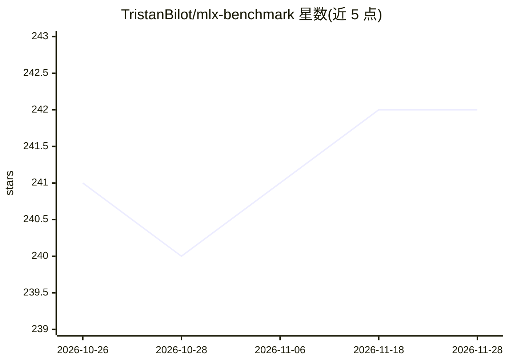

# TristanBilot/mlx-benchmark

⭐ 242 · Python · MIT · 推送 2026-11-20 · [GitHub](https://github.com/TristanBilot/mlx-benchmark) · 个人维护

**在 Apple Silicon 与 CUDA GPU 上跑 MLX 算子基准测试的工具**

对 Apple MLX 的操作与层做基准测试的仓库：在 M1 至 M6 系列 Apple Silicon 芯片上测量 MLX 算子在 GPU/CPU 的运行时，并与 PyTorch 的 mps/cpu/cuda 后端对比。提供详细基准与平均耗时两种结果形式，图表（排名与热力图）由 run_viz.py 从汇总数据自动生成，社区可通过 PR 提交新设备或新算子的基准结果。macOS 上用 conda 创建 osx-arm64 环境安装；非 macOS 设备仅能运行 torch 实验。

## 筛选速览

| 维度 | 判定 | 备注 |
|---|---|---|
| AI 角色 | `ai-ecosystem` | LLM/agent 周边工具 |
| 许可风险 | `permissive` | MIT |
| 部署形态 | `library` | 以包/库形式分发 |
| 模型依赖 | — | README 未给出锁定关系 |
| 硬件要求 | — | 无带数字的原话,不猜 |
| 安装摩擦 | `medium` | 含编译或系统依赖之一 |
| 成熟度 | — | 结构信号不足 |

## 能力要点

- 覆盖 M1–M6 全系 Apple Silicon 芯片及 RTX4090/V100/A100 等 CUDA GPU
- 测量 MLX GPU/CPU 与 PyTorch mps/cpu/cuda 后端的运行时对比
- 默认包含 mx.compile 编译后的算子，可用 --compile=False 关闭
- 图表随 PR 合并自动再生成，支持社区提交新设备基准

## 适用场景

- 在选购或对比 Apple Silicon 芯片时查看 MLX 算子性能排名
- 对比 MLX GPU 与 PyTorch MPS 在各算子上的耗时差异
- 为新设备或新版本 MLX 提交基准数据

## 场景标签

 · 领域:深度学习框架性能基准测试

## 证据(README 行号)

> L4: This repo aims to benchmark Apple's MLX operations and layers, on all Apple Silicon chips, along with some GPUs.
> L24: Benchmarks are generated by measuring the runtime of every `mlx` operations on GPU and CPU, along with their equiva

## 星数曲线

2026-10-26 241 → 2026-11-28 242（+1）

---
*卡片 v1 · prompt 1.4 · 生成 2026-11-25 · 置信度 high · 依据 README sha `58ac4eba42f5` · [字段定义](../../DATASET.md)*
