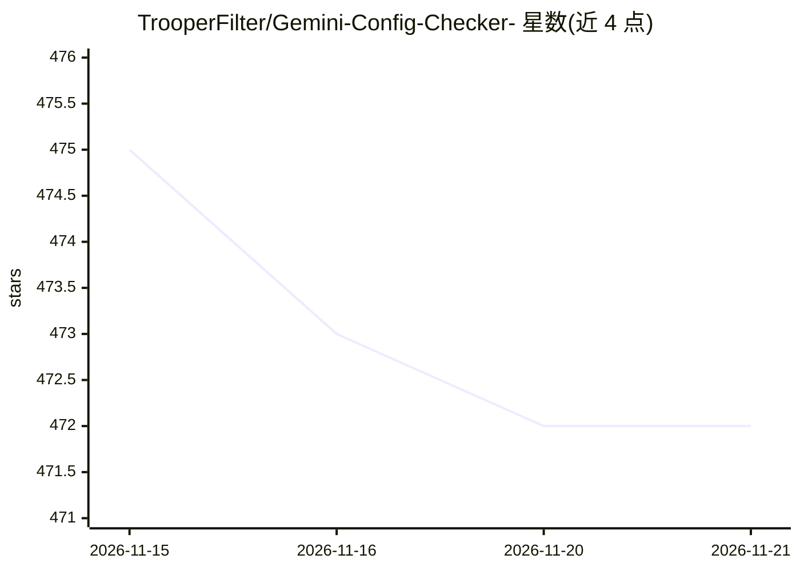

# TrooperFilter/Gemini-Config-Checker-

⭐ 472 · Makefile · Apache-2.0 · 推送 2026-11-15 · [GitHub](https://github.com/TrooperFilter/Gemini-Config-Checker-) · 个人维护

**扫描代理配置能否进入 Gemini 与 AI Studio 的区域检测工具**

代理配置批量测试工具：对 vless/vmess/trojan/ss 配置或订阅链接逐条测试，通过登录后的浏览器读取 Google 对 AI Studio 与 Gemini 的区域判定（而非仅连通性探测），支持 Simple（直测自有配置）与 Advanced（基配置后串联免费配置换出口）两种模式，内置源自 PattN 配方的抗 DPI 档案（TLS ClientHello 分片、ALPN、密码套件）。提供 Windows/macOS/Linux 桌面与 Android APK、web server 构建；区域检测需 Chrome/Edge/Brave，Android 仅连通模式。版本 0.1.0 早期预发布，目前仅在 Windows 上完整运行过。

## 筛选速览

| 维度 | 判定 | 备注 |
|---|---|---|
| AI 角色 | `ai-ecosystem` | LLM/agent 周边工具 |
| 许可风险 | `permissive` | Apache-2.0 |
| 部署形态 | `desktop` | 安装包/桌面程序 |
| 模型依赖 | — | README 未给出锁定关系 |
| 硬件要求 | — | 无带数字的原话,不猜 |
| 安装摩擦 | `medium` | 含编译或系统依赖之一 |
| 成熟度 | `idea` | |

## 能力要点

- 以登录后浏览器读取 Google 区域判定，区分 AI Studio / Gemini 各自封锁状态
- Simple / Advanced 两模式，Advanced 支持基配置串联免费配置形成链式出口
- 可编辑的抗 DPI 配置（Finalmask 分片、ALPN、密码套件），本地转发器实现分片算法
- 桌面（Windows/macOS/Linux）、Android APK 与 web server 多形态发布

## 适用场景

- 批量检测手头代理配置哪些能真正打开 Gemini / AI Studio
- Cloudflare 配置可连但被 Google 屏蔽出口时，寻找可用的串联免费配置
- 在 DPI 过滤网络内验证抗 DPI 配置的可用性

## 场景标签

`浏览器自动化` · 领域:效率与自动化

## 证据(README 行号)

> L11: Find proxy configs that actually get you into **Google AI Studio and Gemini**, by testing each one the way a person
> L50: Google decides region availability **per signed-in account, after the page has loaded**. A plain HTTP request (even

## 星数曲线

2026-11-15 475 → 2026-11-21 472（-3）

---
*卡片 v1 · prompt 1.4 · 生成 2026-11-17 · 置信度 high · 依据 README sha `846e83cebb20` · [字段定义](../../DATASET.md)*
