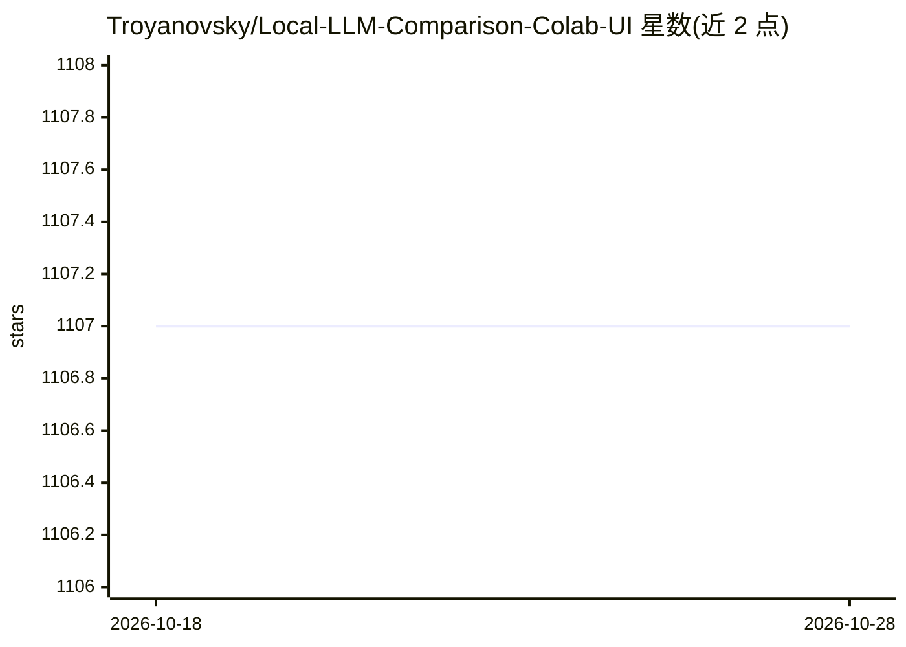

# Troyanovsky/Local-LLM-Comparison-Colab-UI

⭐ 1,107 · Jupyter Notebook · 推送 2026-01-13 · [GitHub](https://github.com/Troyanovsky/Local-LLM-Comparison-Colab-UI) · 个人维护

**本地可跑的开源 LLM 清单：附 Colab 试运行链接与备注**

个人维护的本地部署 LLM 聚合清单（标注 WIP）：最初目标是对 7B/13B 级可在消费级硬件运行的模型用 GPT-4 评分比较，后因模型迭代过快改为不再打分，只提供各模型的 Colab WebUI 链接，用户点击即可在 Colab 中自行试用，附 Hugging Face 模型页与简短备注（参数规模、审查情况、角色扮演表现、编程/数学能力等），条目更新至 2024 年 6 月。

## 筛选速览

| 维度 | 判定 | 备注 |
|---|---|---|
| AI 角色 | `ai-knowledge` | 知识聚合/清单类 |
| 许可风险 | `none` | — |
| 部署形态 | `None` |  |
| 模型依赖 | — | README 未给出锁定关系 |
| 硬件要求 | — | 无带数字的原话,不猜 |
| 安装摩擦 | `low` | 无编译、无系统依赖或容器化 |
| 成熟度 | `idea` | |

## 能力要点

- 收录数十个 GGUF 量化模型条目并附 Hugging Face 链接
- 每条目提供 Open in Colab 一键试用入口
- 备注标注参数规模、是否审查、角色扮演/编程等特性

## 适用场景

- 查找可在消费级硬件上本地运行的开源 LLM
- 在 Colab 中直接试运行候选模型再决定选型
- 比较各模型的审查情况与角色扮演、编程表现备注

## 场景标签

`精选清单` · 领域:学习与行业

## 证据(README 行号)

> L1: # Local LLM Comparison & Colab Links (WIP)
> L2: (Update Nov. 27, 2023) The original goal of the repo was to compare some smaller models (7B and 13B) that can be run
> L4: Therefore, I'm only putting Colab WebUI links for the newer models and you can try them out yourselves with a few cl

## 星数曲线

2026-10-18 1,107 → 2026-10-28 1,107（+0）

---
*卡片 v1 · prompt 1.4 · 生成 2026-10-21 · 置信度 high · 依据 README sha `78c2160a07e9` · [字段定义](../../DATASET.md)*
