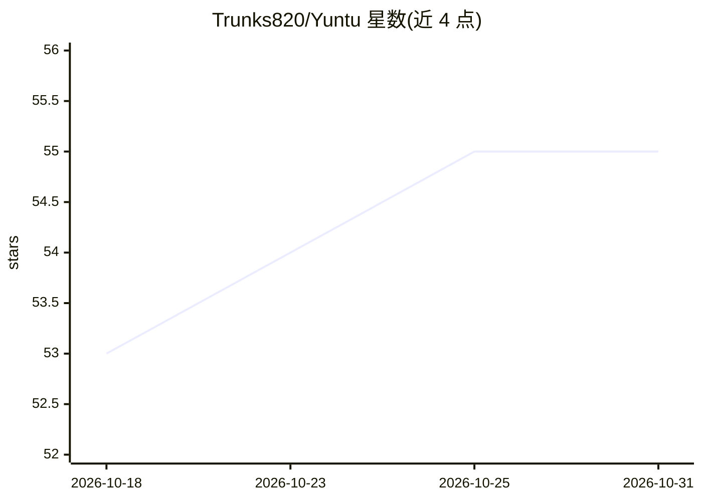

# Trunks820/Yuntu

⭐ 55 · Python · MIT · 推送 2026-09-13 · [GitHub](https://github.com/Trunks820/Yuntu) · [官网](https://kakarot8.com) · 个人维护 · 中文 README

**AI 旅行规划引擎：确定性路线排程 + 事实约束文案生成**

开源的旅行规划引擎源码（FastAPI + React 18 + PostgreSQL）。地点与商圈由 SQL 检索已验证经纬度数据，不交由 LLM 生成；路线基于地理空间算法与高德路径规划，含单日通勤预算与路线可行性硬约束；住宿按到 Top POI 平均通勤距离最短确定性推荐；LLM 仅在结构化事实约束下生成文案，并有质量门禁复核。支持 Gemini、DeepSeek、OpenAI 及 OpenAI 兼容网关。开源版仅内置重庆数据，完整在线版在 kakarot8.com。

## 筛选速览

| 维度 | 判定 | 备注 |
|---|---|---|
| AI 角色 | `ai-native` | 本体是模型或模型工具 |
| 许可风险 | `permissive` | MIT |
| 部署形态 | `library` | 以包/库形式分发 |
| 模型依赖 | — | README 未给出锁定关系 |
| 硬件要求 | — | 无带数字的原话,不猜 |
| 安装摩擦 | `low` | 无编译、无系统依赖或容器化 |
| 成熟度 | — | 结构信号不足 |

## 能力要点

- 地点由 SQL 检索已验证 POI 数据，不由 LLM 生成
- 地理空间算法 + 高德路径规划的确定性路线排程与可行性硬约束
- LLM 仅在结构化事实约束下生成文案，含 Publish Gate 质量门禁
- 提供异步任务 API 与 SSE 流式进度推送

## 适用场景

- 自建并二次开发旅行规划服务
- 体验确定性 Agent 架构的 LLM 落地实现
- 为重庆等城市生成含真实 POI 与通勤信息的行程

## 场景标签

`AI 写作` · 领域:内容生成

## 证据(README 行号)

> L27: **Yuntu 采用“确定性核心 + 创造性外围”的生产级架构**：
> L32: - **文案与建议**：LLM 仅在“结构化事实约束（Structured Evidence Payload）”下编写润色，杜绝编造。
> L62:  > 为避免用户因缺少其他城市 POI 数据库而导致规划失败，**首页（山河地图与经典胶囊模式）默认聚焦并仅展示重庆**。如需扩展其他城市（如成都、西安、北京、上海等），只需向本地数据库 `travel_canonical_pla

## 星数曲线

2026-10-18 53 → 2026-10-31 55（+2）

---
*卡片 v1 · prompt 1.4 · 生成 2026-10-24 · 置信度 mid · 依据 README sha `1ad718a9fef3` · [字段定义](../../DATASET.md)*
