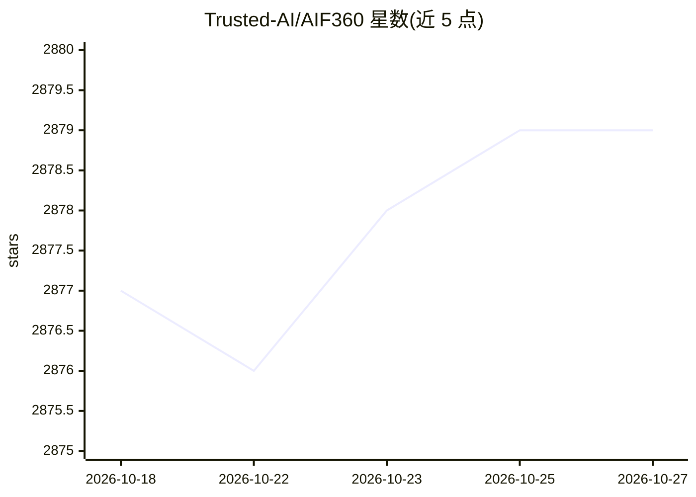

# Trusted-AI/AIF360

⭐ 2,879 · Python · Apache-2.0 · 推送 2026-06-15 · [GitHub](https://github.com/Trusted-AI/AIF360) · [官网](https://aif360.res.ibm.com/) · 组织维护

**检测与缓解机器学习偏差的公平性工具库（Python/R）**

由 IBM Trusted-AI 维护的开源库，提供数据集与模型的偏差检测指标（组公平性、广义熵指数等）、指标解释，以及 15 种偏差缓解算法（预处理/过程中/后处理），覆盖金融、人力、医疗、教育等场景。以 Python 与 R 双语言包形式发布，Python 支持 pip/conda 安装并可按算法选用 extras（TensorFlow、CVXPY 等为特定算法的可选依赖），附带 Jupyter 教程与示例。

## 筛选速览

| 维度 | 判定 | 备注 |
|---|---|---|
| AI 角色 | `ai-ecosystem` | LLM/agent 周边工具 |
| 许可风险 | `permissive` | Apache-2.0 |
| 部署形态 | `library` | 以包/库形式分发 |
| 模型依赖 | — | README 未给出锁定关系 |
| 硬件要求 | — | 无带数字的原话,不猜 |
| 安装摩擦 | `low` | 无编译、无系统依赖或容器化 |
| 成熟度 | `idea` | |

## 能力要点

- 数据集与模型的全面公平性指标集及解释
- 15 种偏差缓解算法（含 Reweighing、Adversarial Debiasing 等）
- Python 与 R 双语言包（PyPI 与 CRAN）
- 附带教程、示例 notebook 与选型指引材料

## 适用场景

- 在模型上线前检测训练数据与预测结果中的偏差
- 用预处理或后处理算法缓解模型偏差
- 在金融、医疗等受监管场景做公平性合规评估

## 场景标签

 · 领域:可信 AI/机器学习公平性

## 证据(README 行号)

> L8: The AI Fairness 360 toolkit is an extensible open-source library containing techniques developed by the
> L12: 1) a comprehensive set of metrics for datasets and models to test for biases,
> L14: 3) algorithms to mitigate bias in datasets and models.

## 星数曲线

2026-10-18 2,877 → 2026-10-27 2,879（+2）

---
*卡片 v1 · prompt 1.4 · 生成 2026-10-21 · 置信度 high · 依据 README sha `05fbc82a6eca` · [字段定义](../../DATASET.md)*
