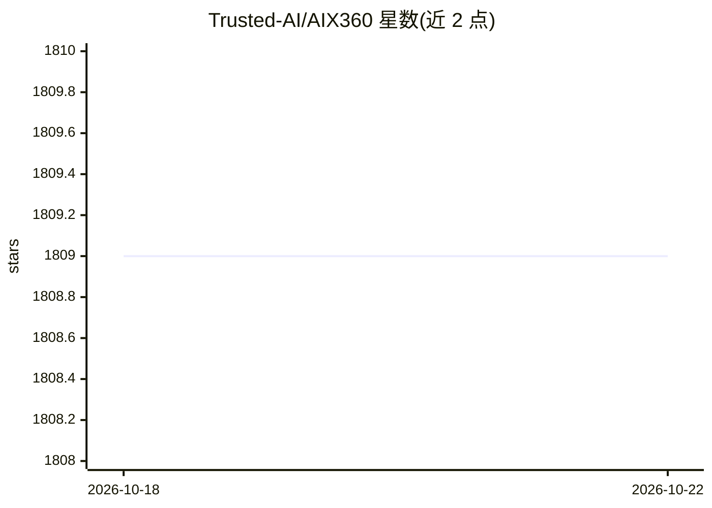

# Trusted-AI/AIX360

⭐ 1,808 · Python · Apache-2.0 · 推送 2026-09-05 · [GitHub](https://github.com/Trusted-AI/AIX360) · [官网](https://aix360.res.ibm.com/) · 组织维护

**IBM 的机器学习模型与数据可解释性算法工具库**

AI Explainability 360 是 IBM Research 开源的可解释性/可解释度 Python 库，面向数据科学家，提供覆盖数据解释、局部/全局、事后/直接解释等多维度的一组算法（ProtoDash、CEM、LIME、SHAP、时间序列显著性等）以及 Faithfulness/Monotonicity 解释性度量，支持表格、文本、图像和时间序列数据。安装按算法关键字选择性安装依赖，部分算法依赖不同 Python 版本、不能共装于同一环境；提供 Docker 运行方式与 Jupyter 示例教程。

## 筛选速览

| 维度 | 判定 | 备注 |
|---|---|---|
| AI 角色 | `ai-ecosystem` | LLM/agent 周边工具 |
| 许可风险 | `permissive` | Apache-2.0 |
| 部署形态 | `self-host` | docker 或自建部署 |
| 模型依赖 | — | README 未给出锁定关系 |
| 硬件要求 | — | 无带数字的原话,不猜 |
| 安装摩擦 | `low` | 无编译、无系统依赖或容器化 |
| 成熟度 | `idea` | |

## 能力要点

- 覆盖数据/局部/全局、事后/直接等多类别的解释算法集合
- 支持表格、文本、图像、时间序列四类数据
- 提供 Faithfulness、Monotonicity 解释性度量
- 按算法关键字（如 rbm,dipvae,tsice）选择性安装依赖

## 适用场景

- 为已训练的机器学习模型生成局部或全局解释
- 对比和挑选适合用例的解释算法（附分类树指南）
- 用解释性度量评估解释质量

## 场景标签

 · 领域:机器学习/可信 AI 工具

## 证据(README 行号)

> L9: The AI Explainability 360 toolkit is an open-source library that supports interpretability and explainability of dat
> L13: There is no single approach to explainability that works best. There are many ways to explain: data vs. model, dire

## 星数曲线

2026-10-18 1,809 → 2026-10-22 1,809（+0）

---
*卡片 v1 · prompt 1.4 · 生成 2026-10-21 · 置信度 high · 依据 README sha `2f93b6cdc49a` · [字段定义](../../DATASET.md)*
