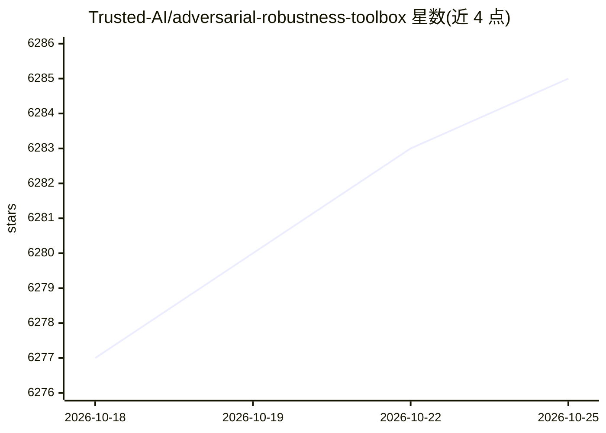

# Trusted-AI/adversarial-robustness-toolbox

⭐ 6,285 · Python · MIT · 推送 2026-10-23 · [GitHub](https://github.com/Trusted-AI/adversarial-robustness-toolbox) · [官网](https://adversarial-robustness-toolbox.readthedocs.io/en/latest/) · 组织维护 · 中文 README

**机器学习安全 Python 库：攻防评测模型的对抗威胁工具**

由 Linux Foundation AI & Data 托管的 Python 库，面向开发者和研究者，提供针对机器学习模型的对抗威胁工具，覆盖 Evasion（规避）、Poisoning（投毒）、Extraction（抽取）、Inference（推断）四类攻防场景，可服务于红队与蓝队。支持 TensorFlow、Keras、PyTorch、scikit-learn、XGBoost 等主流框架，覆盖图像、表格、音视频等数据类型与分类、目标检测、语音识别、生成、认证等任务。库处于持续开发中，提供安装文档、示例与 Notebook。

## 筛选速览

| 维度 | 判定 | 备注 |
|---|---|---|
| AI 角色 | `ai-ecosystem` | LLM/agent 周边工具 |
| 许可风险 | `permissive` | MIT |
| 部署形态 | `library` | 以包/库形式分发 |
| 模型依赖 | — | README 未给出锁定关系 |
| 硬件要求 | — | 无带数字的原话,不猜 |
| 安装摩擦 | `low` | 无编译、无系统依赖或容器化 |
| 成熟度 | — | 结构信号不足 |

## 能力要点

- 覆盖 Evasion/Poisoning/Extraction/Inference 四类对抗威胁的攻击与防御工具
- 支持 TensorFlow/Keras/PyTorch/scikit-learn 等主流框架
- 覆盖图像、表格、音频、视频等数据类型与多种 ML 任务
- 同时面向红队（攻击）与蓝队（防御）场景

## 适用场景

- 评测机器学习模型对对抗样本攻击的鲁棒性
- 红队发起对抗攻击测试模型安全性
- 蓝队为模型部署防御措施
- 在分类、目标检测、语音识别等任务上做安全评估

## 场景标签

`网络安全` · 领域:学习与行业

## 证据(README 行号)

> L19: Adversarial Robustness Toolbox (ART) is a Python library for Machine Learning Security. ART is hosted by the
> L21: developers and researchers to defend and evaluate Machine Learning models and applications against the

## 星数曲线

2026-10-18 6,277 → 2026-10-25 6,285（+8）

---
*卡片 v1 · prompt 1.4 · 生成 2026-10-20 · 置信度 high · 依据 README sha `f5740d5ce7d8` · [字段定义](../../DATASET.md)*
